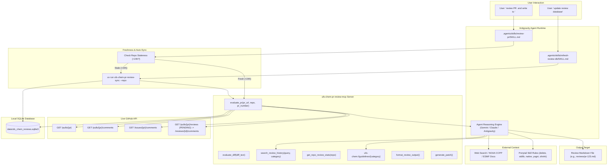
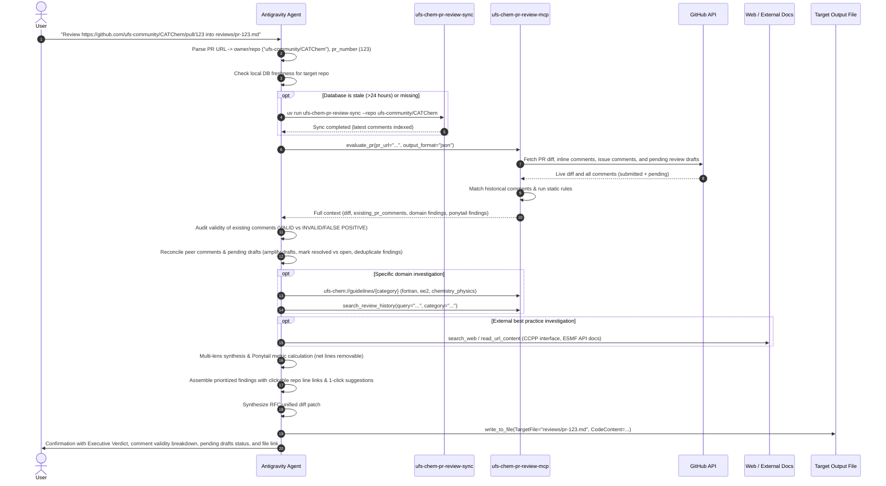

# Feature: Workspace Skills for Historical Database Refresh and Deep-Dive Pull Request Code Review

Refined 2026-10-21 from `design/feat/20261007-1615-initial-imp/20261021-0914-refresh-skill.md`. Expands the `ufs-chem-pr-review-mcp` ecosystem by introducing two specialized Antigravity workspace skills: `refresh-review-db` for seamless synchronization of the historical review knowledge base, and `review-pr` for autonomous, deep-dive code reviews driven by a PR URL and target output file path. Always pulls down existing live review comments, conversation threads, and unsubmitted pending review drafts from GitHub to prevent duplicate feedback, critically evaluates the validity of all prior comments against actual code and domain physics, and enforces a frequent refresh strategy to maintain fresh historical context and live PR data.

# session

- **Session ID**: `56b2c61b-4425-4a37-ab46-db9fdcfd7aff`
- **Resume Command**: `agy --resume 56b2c61b-4425-4a37-ab46-db9fdcfd7aff`

## Goal

Provide two first-class Antigravity workspace skills located in `.agents/skills/` that turn `ufs-chem-pr-review-mcp` into an interactive, zero-friction developer review assistant:

1. **`refresh-review-db` Skill (`.agents/skills/refresh-review-db/SKILL.md`)**:
   - Encapsulates the complete database synchronization workflow for `data/ufs_chem_reviews.sqlite3`.
   - Handles GitHub authentication preflight checks (`gh auth token`, `UFS_CHEM_GITHUB_TOKEN`, `GITHUB_TOKEN`).
   - Supports both full-ecosystem refresh across all configured repositories (`config/repositories.yaml`) and targeted single-repository updates (`--repo <owner/repo>`).
   - Configures retention and pruning policies (`--retention-days`, `--max-records`).
   - Verifies synchronization integrity by reporting synced PR counts, indexed comment volumes, and database statistics via `get_repo_review_stats` or SQLite inspection.
   - Serves as the automated engine called by `review-pr` whenever target repository data is stale.

2. **`review-pr` Skill (`.agents/skills/review-pr/SKILL.md`)**:
   - Enables the user to initiate a comprehensive, multi-lens code review simply by specifying:
     1. A GitHub Pull Request URL (e.g., `https://github.com/ufs-community/CATChem/pull/123`).
     2. A target markdown file path to write the review to (e.g., `reviews/CATChem-pr-123.md`).
   - Parses and decomposes arbitrary GitHub PR URLs (`https://github.com/owner/repo/pull/123`, `.../pull/123/files`, or shorthand `owner/repo#123`).
   - **Frequent Refresh Enforcement**:
     - Pre-review staleness check: inspects the local database (`data/ufs_chem_reviews.sqlite3`) for the target repository's latest indexed comment timestamp. If missing or older than 24 hours, automatically executes a fast incremental sync (`uv run ufs-chem-pr-review-sync --repo <target_repo>`) before conducting the review.
     - Live, un-cached data fetching: always retrieves fresh PR diff and active comments directly from GitHub upon every invocation.
   - **Always Pulls Down Existing & Pending PR Comments**:
     - Fetches submitted inline diff review comments (`/repos/{owner}/{repo}/pulls/{pr_number}/comments`), conversation thread comments (`/repos/{owner}/{repo}/issues/{pr_number}/comments`), and any unsubmitted pending review draft comments (`/repos/{owner}/{repo}/pulls/{pr_number}/reviews` -> filter `state == "PENDING"` -> `/repos/{owner}/{repo}/pulls/{pr_number}/reviews/{review_id}/comments`).
     - Incorporates in-progress draft feedback: honors the user's unsubmitted pending review notes, validates and expands them with domain/standards checks, prevents duplicate suggestions, and highlights them as `[PENDING DRAFT]` in the output report.
     - Performs live thread reconciliation: cross-references existing comments against the current diff, identifies which peer reviewer requests have already been addressed in newer commits, flags unresolved questions, and eliminates redundant duplicate suggestions.
   - **Critically Evaluates the Validity of Existing Comments**:
     - Audits every existing submitted peer comment and pending draft comment against the actual PR diff, domain physics (chemistry unit scaling, mass conservation, photolysis rates), NOAA OMD coding standards (Flux Fortran, Forge C++, Aero Python), and Ponytail over-engineering principles.
     - Classifies each comment into a deterministic validity taxonomy:
       - `[VALID]`: Accurately identifies a genuine correctness defect, physics bug, or standards violation.
       - `[INVALID / FALSE POSITIVE]`: Incorrectly flags safe or intentional patterns (e.g. confusing volume vs mass mixing ratios, suggesting vector slicing on recurrent loops with data dependencies, or violating NOAA guidelines).
       - `[OUTDATED]`: Valid for an earlier commit SHA but obsolete in the current diff.
       - `[PARTIALLY VALID]`: Valid observation, but proposes a flawed or over-engineered fix.
     - Provides clear, evidence-based technical commentary explaining *why* the comment is valid or invalid, assisting the PR author and reviewers in resolving disputed feedback.
   - Queries the local `ufs-chem-pr-review-mcp` server tools (`evaluate_pr`, `evaluate_diff`, `search_review_history`, `get_repo_review_stats`, `format_review_output`, `generate_patch`) and guidelines resources (`ufs-chem://guidelines/{category}`).
   - Conducts a thorough, multi-lens evaluation:
     - **Lens 1: Ponytail Over-Engineering Audit** — Identifies dead code (`delete`), reinvented standard libraries (`stdlib`), native platform capabilities (`native`), speculative abstractions (`yagni`), and simplifications (`shrink`). Quantifies the net lines of code and dependencies removable.
     - **Lens 2: NOAA OMD Standards & NCO EE2 Operations** — Enforces Flux Fortran 2018+ (explicit kinds `1.0_rk`, pure kernels, OpenMP `default(none)`), Forge C++23 (strict RAII, zero raw owning pointers, `std::mdspan`), Aero Python (lazy Dask execution, typed APIs), and EE2 environmental standards ($DATA, $COMROOT, standard fatal error traps, zero background jobs).
     - **Lens 3: UFS-Chem Domain & Atmospheric Physics/Chemistry** — Validates molar-to-mass mixing ratio scaling ($M_{spec} / M_{air}$ for ppm/ppb to kg/kg), photolysis mass conservation, dynamic memory allocation status checks (`stat=rc, errmsg=msg`), and ESMF/NUOPC return code checks (`rc == ESMF_SUCCESS`).
     - **Lens 4: Historical Community Review Precedents** — Injects matching historical PR comments and follow-up diffs from the 5 tracked repositories to flag recurring pitfalls and cite past fixes.
     - **Lens 5: Online Best Practices & CCPP Ecosystem References** — Researches external web documentation (e.g. CCPP physics scheme interfaces, NetCDF conventions, modern ESMF release notes) when novel dependencies or specialized schemes appear.
   - Formats the output as a clean, human-readable, prioritized review document containing:
     - Executive Verdict & Summary with Ponytail metrics (Net lines removable).
     - Existing PR Review Discussions, Validity Assessment & Status (peer feedback summary, pending drafts, validity verdicts, and resolution states).
     - Prioritized Action Items Table (P0 Blocker, P1 Major, P2 Moderate, P3 Minor/Nit).
     - Detailed Findings with precise file path and line number mapping (`file:///path/to/file#L123-L145`).
     - 1-Click Applyable GitHub Suggestions (````suggestion\n...\n````) and Unified Diff Patches compatible with `git apply`.
   - Writes the formatted review directly to the user's requested output file path.

---

## Pre-design audit (fresh facts, 2026-10-21)

1. **Repository & MCP Server Architecture (`src/ufs_chem_pr_review_mcp/`)**:
   - `server.py` implements FastMCP STDIO server exposing 6 tools:
     - `evaluate_diff`: Analyzes raw diff text, matches historical comments, executes domain and ponytail audits.
     - `evaluate_pr`: Fetches PR diff from GitHub, runs domain and ponytail checks, retrieves matching review context.
     - `search_review_history`: FTS5 full-text keyword and metadata search over historical PR comments.
     - `get_repo_review_stats`: Summarizes PR counts, comments, top reviewers, and followup acceptance rates.
     - `format_review_output`: Converts findings into Markdown, GitHub Review API JSON, or unified diff patch.
     - `generate_patch`: Combines structured `CodePatch` items into a unified diff string.
   - `server.py` exposes resources:
     - `ufs-chem://repositories`: JSON catalog of tracked repositories.
     - `ufs-chem://guidelines`: JSON list of guideline categories.
     - `ufs-chem://guidelines/{category}`: Detailed markdown guidelines for `fortran`, `cpp`, `bash`, `python`, `ee2`, `hpc-libraries`, `chemistry_physics`, `esmf_nuopc`, and `ponytail`.
   - All tools declare `readOnly: True` in `annotations`, preventing invasive confirmation prompts in MCP client hosts.

2. **Existing CLI Sync Engine (`src/ufs_chem_pr_review_mcp/cli/sync.py`)**:
   - CLI command registered in `pyproject.toml` as `ufs-chem-pr-review-sync`.
   - Options: `--config`, `--db`, `--repo`, `--token`, `--retention-days`, `--max-records`, `--log-level`.
   - Authentication: `resolve_github_token` automatically checks explicit token, `gh auth token` via local GitHub CLI, `UFS_CHEM_GITHUB_TOKEN`, and `GITHUB_TOKEN`.
   - Local database resides at `data/ufs_chem_reviews.sqlite3` with full FTS5 search tables and indices.
   - Config file `config/repositories.yaml` configures the 5 tracked repositories: `ufs-community/CATChem`, `ufs-community/CECE`, `noaa-emc/HELM`, `benkozi/ufs-chem-assay`, and `ufs-community/ufs-chem-container`.

3. **Active & Pending PR Comments API Audit (`GitHubClient` in `src/ufs_chem_pr_review_mcp/ingest/client.py`)**:
   - `GitHubClient.get_pr_comments(repo, pr_number)` is already implemented (`/repos/{repo}/pulls/{pr_number}/comments`). It retrieves submitted inline code review comments including diff hunks, file paths, line coordinates, and thread reply chains (`in_reply_to_id`).
   - Adding `get_issue_comments(repo, pr_number)` (`/repos/{repo}/issues/{pr_number}/comments`) provides full coverage of conversational/top-level comments posted on the PR by reviewers or CI bots.
   - **Pending Review Drafts API**:
     - The GitHub review state machine allows reviewers to create in-flight comments before formally submitting their review. When a review is in draft, its state is `PENDING`.
     - `GET /repos/{owner}/{repo}/pulls/{pull_number}/reviews` lists reviews on the PR. For the authenticated user, any unsubmitted review appears with `"state": "PENDING"`.
     - `GET /repos/{owner}/{repo}/pulls/{pull_number}/reviews/{review_id}/comments` fetches the pending comments attached to that draft review, providing line coordinates, diff hunks, and draft bodies before they are visible to other reviewers.
     - GitHub strictly scopes pending review visibility to the authenticated creator. Since the agent authenticates via `resolve_github_token` (from `gh auth token` or `GITHUB_TOKEN`), it can natively pull the user's pending drafts while honoring GitHub's security boundary.
   - Integrating submitted comments, issue comments, and pending review draft comments into `evaluate_pr` and `GitHubClient` fulfills the requirement to "always pull down existing comments on the PR" and "use pending comments too".

4. **Freshness Tracking & Auto-Refresh Mechanics**:
   - Local database tracks indexed review comments with `created_at` timestamps.
   - Querying `SELECT max(c.created_at) FROM review_comments c JOIN pull_requests p ON c.pr_id = p.id JOIN repositories r ON p.repo_id = r.id WHERE r.name = ?` or using `get_repo_review_stats(repo)` immediately indicates whether a repository's review knowledge is fresh.
   - Establishing a staleness threshold (e.g. >24 hours) allows the `review-pr` skill to trigger `ufs-chem-pr-review-sync --repo <target_repo>` on-demand before running the review, keeping the local knowledge base synchronized relatively often with minimal overhead.

5. **Peer Review Validity in Scientific Modeling & HPC**:
   - Peer reviews in scientific Fortran/C++ codebases frequently introduce false positives or conflicting guidance due to domain complexity:
     - *Physical unit misconceptions*: Reviewers assuming mixing ratios are volume-based (ppmv) when code has already scaled to mass mixing ratios (kg/kg).
     - *Vectorization/Loop dependencies*: Recommending modern Fortran array slicing on loops that possess subtle loop-carried recurrences ($x(i) = x(i-1) + a(i)$) that require sequential execution.
     - *OpenMP scoping errors*: Suggesting thread parallelization without noticing shared scratch arrays or thread-unsafe module globals.
     - *Over-engineering suggestions*: Recommending elaborate OOP wrapper classes that violate Ponytail YAGNI principles.
   - Evaluating the validity of existing comments protects authors from making erroneous changes based on flawed reviewer advice and accelerates PR merging.

6. **Antigravity Customization Discovery & Skill Structure**:
   - Discovered in `.agents/skills/<skill-name>/SKILL.md` at workspace root.
   - Skill instructions must begin with YAML frontmatter:
     ```yaml
     ---
     name: skill-name
     description: >-
       Third-person description explaining when and why the agent should activate the skill.
     ---
     ```
   - Progressive disclosure: Agent reads only name and description until triggered; once activated, the agent reads `SKILL.md` to execute the runbook.
   - Currently, `.agents/` contains `.agents/rules/` (`fortran.instructions.md`, `cpp.instructions.md`, `bash.instructions.md`, `python.instructions.md`, `ee2-standards.md`, `hpc-libraries.md`), but no `.agents/skills/` directory exists yet.

---

## Design

### 0. Decisions

- **Decision 0.1: Skill Directory Layout in `.agents/skills/`**:
  - Implement two dedicated skill folders in `.agents/skills/`:
    - `.agents/skills/refresh-review-db/SKILL.md`: Runbook and automation for database sync.
    - `.agents/skills/review-pr/SKILL.md`: Runbook for executing deep-dive PR reviews from a URL to a file.
  - Keeps skills co-located within the workspace repository under version control so all project contributors share identical review procedures.

- **Decision 0.2: Native URL Parsing Support in the Codebase**:
  - Add `parse_github_pr_url` utility in `src/ufs_chem_pr_review_mcp/models/github.py` (or `ingest/client.py`) using regex matching:
    `r"^https?://github\.com/([^/]+/[^/]+)/pull/(\d+)(?:/.*)?$"` and shorthand `r"^([^/#]+/[^/#]+)#(\d+)$"`.
  - Update `evaluate_pr` in `src/ufs_chem_pr_review_mcp/server.py` to accept `pr_url: str | None = None` in addition to `repo: str | None = None` and `pr_number: int | None = None`.
  - If `pr_url` is passed, `evaluate_pr` decomposes it into `repo` and `pr_number` automatically, gracefully returning structured error JSON if the URL is invalid.

- **Decision 0.3: Live PR Comment Ingestion, Pending Drafts & Validity Assessment**:
  - In `evaluate_pr`, call `client.get_pr_comments()`, `client.get_issue_comments()`, and `client.get_pending_review_comments()` live from GitHub.
  - Package these comments into `ExistingPrComment` Pydantic models with `is_pending: bool = False`, `review_id: int | None = None`, and `review_state: str | None = None`.
  - The `review-pr` skill runbook instructs the agent to:
    1. Ingest both submitted peer comments and the user's unsubmitted pending draft comments.
    2. Assess the **validity** of each existing comment: evaluate the claim against actual code logic, domain physics, NOAA OMD standards, and Ponytail principles.
    3. Categorize validity: `VALID`, `INVALID` (false positive), `OUTDATED`, or `PARTIALLY_VALID`, providing technical rationale.
    4. Reconcile existing peer comments against the latest diff to mark resolved vs open concerns.
    5. Honor and amplify the user's pending comments: treat them as high-priority user intent, elaborate on them with domain rules (Flux Fortran, OMD standards, mass conservation), and ensure no duplicate suggestions are made.
    6. Present validity findings distinctly in Section 2 of the output report.

- **Decision 0.4: Frequent Refresh Cadence & Pre-Review Staleness Check**:
  - In `review-pr`, before analyzing the PR, execute a database freshness check:
    - Query `ReviewDatabase.get_latest_comment_timestamp(target_repo)` (or `get_repo_stats`).
    - If the latest indexed comment is older than 24 hours (or if the repo has 0 indexed records), automatically execute `uv run ufs-chem-pr-review-sync --repo <target_repo>` before proceeding.
    - This ensures the local historical review index stays fresh without requiring separate manual sync steps.
  - Live PR diff and comments are always fetched with zero caching (cache-bypass).

- **Decision 0.5: Human-Readable, Actionable Markdown Report Schema**:
  - The review output file written by the agent must adhere to a standardized, high-density format:
    1. Header: PR title, author, target branch, reviewed commit SHA, review timestamp, verdict.
    2. Executive Summary: Risk assessment, key architectural observations, Ponytail metrics (net lines removable, dependencies to cut).
    3. Existing PR Review Discussions, Validity Assessment & Status: Summary of existing peer reviewer comments and pending review drafts, with explicit validity verdicts (`[VALID]`, `[INVALID]`, `[OUTDATED]`) and resolution states.
    4. Prioritized Action Items Table: Severity (Blocker, Major, Moderate, Minor, Nit), File, Line, Category, Summary.
    5. Detailed Findings: For each finding, exact repo file path, line numbers, issue description, rationale/citation, and a 1-click GitHub ````suggestion ```` replacement block.
    6. Machine-Applicable Unified Diff Patch: Fenced `diff` block matching RFC-compliant unified diff format, ready for `git apply`.
    7. Historical Precedents & Context: Citations to matching past PR discussions and follow-ups.

- **Decision 0.6: TDD and Strict Pydantic Typing**:
  - New models (`PrUrlComponents`, `ExistingPrComment`, `CommentValidity`, `ExistingCommentEvaluation`, extended `ReviewContextResponse`) use strict Pydantic v2 models with field descriptions and `extra="forbid"`.
  - Avoid `Any` in all signatures.
  - Dedicated unit tests added to `tests/test_github_url.py` and `tests/test_mcp_server.py`.

---

### 1. Architecture & Component Layout



---

### 2. Skill 1: Database Refresh & Sync Skill (`refresh-review-db`)

#### Directory Location
`.agents/skills/refresh-review-db/SKILL.md`

#### Frontmatter
```yaml
---
name: refresh-review-db
description: >-
  Sync and update the historical PR review database (data/ufs_chem_reviews.sqlite3)
  across UFS-Chem repositories using ufs-chem-pr-review-sync. Use this skill whenever
  the user asks to update, refresh, or sync the review database, or before running
  reviews on recently updated repositories.
---
```

#### Skill Specification & Workflow Steps
1. **Step 1: Environment & Authentication Preflight Check**:
   - Check if GitHub authentication is active:
     - Run `gh auth status` via `run_command`.
     - If authenticated, `resolve_github_token` in `sync.py` will automatically pick up the token from `gh auth token`.
     - If unauthenticated, check if `UFS_CHEM_GITHUB_TOKEN` or `GITHUB_TOKEN` is present in the environment.
     - If no token is detected, notify the user with clear instructions:
       `"Please authenticate with GitHub CLI via 'gh auth login' or set GITHUB_TOKEN."`
2. **Step 2: Configuration & Parameter Assessment**:
   - Verify `config/repositories.yaml` exists and check configured repositories (`CATChem`, `CECE`, `HELM`, `ufs-chem-assay`, `ufs-chem-container`).
   - Determine whether the user requested a full refresh or a specific repository (e.g. `--repo ufs-community/CATChem`).
   - Determine if custom retention or record limits were requested (`--retention-days`, `--max-records`).
3. **Step 3: Execute Sync Command**:
   - Run the sync command in the workspace:
     ```bash
     uv run ufs-chem-pr-review-sync [--repo <repo_name>] [--log-level INFO]
     ```
   - Monitor STDERR logs for progress across PR fetching, diff follow-up calculation, and FTS5 indexing.
4. **Step 4: Verification & Database Health Check**:
   - Verify database file presence at `data/ufs_chem_reviews.sqlite3`.
   - Run a quick verification check using `get_repo_review_stats` or SQLite inspection to confirm newly synced records:
     - Total pull requests indexed.
     - Total review comments indexed.
     - Most recent review timestamp.
5. **Step 5: Completion Summary**:
   - Present a concise, human-readable summary to the user indicating:
     - Repositories synced.
     - Count of pull requests and comments added/updated.
     - Any warnings or API rate limit considerations.

---

### 3. Skill 2: Deep-Dive PR Review Skill (`review-pr`)

#### Directory Location
`.agents/skills/review-pr/SKILL.md`

#### Frontmatter
```yaml
---
name: review-pr
description: >-
  Conduct an in-depth, rigorous code review of a GitHub Pull Request given its URL,
  always pulling down existing and pending review comments and threads on the PR,
  critically evaluating the validity of existing comments against domain physics and rules,
  refreshing the review knowledge base, and synthesizing Ponytail over-engineering analysis,
  NOAA OMD standards, and atmospheric chemistry physics rules, writing the complete prioritized
  review report to a specified file path. Use this skill whenever the user provides a
  PR URL and asks for a review written to a file.
---
```

#### Skill Specification & Multi-Lens Review Runbook

The skill guides the agent through a disciplined 7-phase review pipeline:



##### Phase 0: Freshness Verification & On-Demand Incremental Sync
- Decompose PR URL into `repo` and `pr_number`.
- Query `get_repo_review_stats(repo)` or inspect `data/ufs_chem_reviews.sqlite3` for the most recent indexed timestamp on `repo`.
- If the latest indexed comment is older than 24 hours (or if the repo has not yet been indexed in the database), execute:
  ```bash
  uv run ufs-chem-pr-review-sync --repo <repo>
  ```
- This guarantees the agent always operates on up-to-date historical precedents and reviewer patterns without manual user intervention.

##### Phase 1: Input Validation & Path Preparation
- Validate target output file path (e.g. `reviews/pr-123.md`).
- Ensure all parent directories exist: `Path(target_file).parent.mkdir(parents=True, exist_ok=True)`.

##### Phase 2: Ingestion & Live/Pending Comment Pulling
- Call `evaluate_pr` with `pr_url` (or `repo` and `pr_number`), `output_format="json"`, `review_mode="summary_and_inline"`.
- Under the hood, `evaluate_pr` pulls:
  - Live unified diff.
  - Live inline review comments (`/pulls/{pr}/comments`).
  - Live issue comments and PR conversation threads (`/issues/{pr}/comments`).
  - Live unsubmitted pending review draft comments (`/pulls/{pr}/reviews` -> `state == "PENDING"` -> `/pulls/{pr}/reviews/{review_id}/comments`).
  - Matches against the freshly updated historical SQLite database.
- Receive structured `ReviewContextResponse` including `existing_pr_comments`.

##### Phase 3: Live Discussion Reconciliation & Comment Validity Evaluation
- Inspect all comments in `existing_pr_comments`:
  - **1. Validity Evaluation**:
    - For every comment, evaluate its technical claim against the code in the PR diff:
      - *Physics & Units*: Does the formula actually require molecular weight scaling, or is the variable already converted?
      - *Algorithmic / Language*: Is the suggested array slice syntax safe, or does the loop have recurrence data dependencies ($x(i) = x(i-1) + a(i)$)?
      - *OMD & EE2 Standards*: Does the suggestion violate Flux Fortran (pure functions), Forge C++ (RAII), or EE2 path standards?
      - *Ponytail*: Is the reviewer proposing an over-engineered abstraction?
    - Assign validity:
      - `[VALID]`: Accurately identifies a genuine defect or standards violation.
      - `[INVALID / FALSE POSITIVE]`: Reviewer's claim is mathematically, physically, or architecturally incorrect.
      - `[OUTDATED]`: Formerly valid comment, but rendered moot by a newer commit.
      - `[PARTIALLY VALID]`: Valid observation, but proposed fix is flawed.
    - Write a concise technical rationale for each evaluation.
  - **2. Resolution Status & Reconciliation**:
    - Check whether subsequent commits in the PR modified or resolved the code that was commented on.
    - Mark each thread: `[RESOLVED]` (author pushed changes addressing the comment) or `[OPEN / UNADDRESSED]` (reviewer concern remains unaddressed).
  - **3. Pending Review Draft Reconciliation (`is_pending == True`)**:
    - Treat pending comments as high-priority user intent.
    - Evaluate validity, incorporate the reviewer's in-flight notes directly into the review synthesis, and expand them with domain checks and unified diff patches.
    - Mark in report as `[PENDING REVIEW DRAFT]`.
  - **4. Deduplication Guard**: Do not duplicate findings or suggest fixes for issues that peer reviewers or pending draft comments have already flagged, unless adding critical new evidence or validating the resolution.

##### Phase 4: Multi-Lens Deep Dive & Ponytail Scrutiny
1. **Ponytail Audit**:
   - Inspect every added/modified hunk for speculative complexity, unnecessary helper functions with single callers, redundant wrapper classes, and reinvention of language/stdlib built-ins.
   - Calculate net lines removable: $L_{removable} = L_{dead} + L_{speculative} + L_{shrink\_delta}$.
2. **NOAA OMD Coding Standards**:
   - Fortran: Verify explicit kind suffixes (`_rk` or `_r8`), OpenMP `default(none)`, pure functions for physics compute kernels, and proper `&` continuations.
   - C++: Strict RAII, zero raw owning pointers (`std::unique_ptr` / `std::shared_ptr`), Fortran memory layout ordering.
   - Bash: `set -euo pipefail`, Google style, no backgrounding (`&`), standard exit codes.
   - Python: Aero protocol, lazy evaluation, strict typing.
3. **UFS-Chem Domain & Atmospheric Physics**:
   - Check molar mass conversions ($M_{spec} / M_{air}$).
   - Verify mass conservation in reaction kinetics.
   - Verify error handling on ESMF calls (`ESMF_LogFoundError`).
   - Confirm dynamic allocations have `stat=rc, errmsg=msg`.
4. **Web / External Reference Investigation**:
   - If unfamiliar third-party libraries, novel CCPP physics interfaces, or external NetCDF routines appear, consult online documentation via `search_web` to verify modern API signatures and best practices.

##### Phase 5: Severity Prioritization
Categorize every finding into standard severity levels:
- **P0 — Blocker / Crash / Invalid Physics**: Numerical instability, incorrect molecular weight ratio, memory corruption, uninitialized variable in compute loop, ESMF deadlock.
- **P1 — Major / Architectural Bug**: Missing allocation status checks, resource leaks, OpenMP race conditions, breaking interface changes, violation of EE2 operational standards.
- **P2 — Moderate / Over-Engineering**: Ponytail violations (dead code, reinvented standard library routines, excessive abstractions), non-standard Fortran kinds, non-vectorized scalar loops.
- **P3 — Minor / Nit**: Formatting, documentation typos, comment clarifications.

##### Phase 6: Machine-Applicable Patches & Suggestions
- For every finding, generate:
  - Exact file path and line numbers in the target repo.
  - A GitHub 1-click suggestion block (````suggestion\n<replacement>\n````).
  - A unified diff hunk ready for `git apply`.

##### Phase 7: Output File Generation & User Presentation
- Write the final report to the specified file path using `write_to_file`.
- Respond to the user with:
  - A concise summary of the review verdict (APPROVE / REQUEST CHANGES / COMMENT).
  - Validity breakdown of existing comments (count of valid, invalid/false positive, and resolved comments).
  - Status of pending draft comments (count of incorporated items).
  - High-level count of prioritized findings ($N_{P0}, N_{P1}, N_{P2}, N_{P3}$).
  - Ponytail metric summary (Net lines removable).
  - Clickable markdown link to the generated review file.

---

### 4. Supporting Python Enhancements (URL Parsing, Live & Pending Comments, Validity & MCP Tool Ergonomics)

To ensure both skills and MCP clients can seamlessly pass URLs, fetch live and pending PR comments, evaluate validity, and maintain freshness, we will refine the underlying codebase with the following additions:

#### 4.1 URL Decomposition Helper: `src/ufs_chem_pr_review_mcp/models/github.py`
```python
import re
from pydantic import BaseModel, ConfigDict, Field


class PrUrlComponents(BaseModel):
    """Decomposed components of a GitHub pull request URL."""

    model_config = ConfigDict(extra="forbid", frozen=True)

    owner: str = Field(
        description="GitHub repository owner or organization (e.g. ufs-community)."
    )
    repo: str = Field(description="GitHub repository name (e.g. CATChem).")
    full_repo: str = Field(
        description="Combined full repository name (e.g. ufs-community/CATChem)."
    )
    pr_number: int = Field(description="Pull request number (e.g. 123).")


def parse_github_pr_url(url_or_shorthand: str) -> PrUrlComponents:
    """Parses a GitHub pull request URL or shorthand into its constituent repository and PR number.

    Supported formats:
    - https://github.com/owner/repo/pull/123
    - https://github.com/owner/repo/pull/123/files
    - https://github.com/owner/repo/pull/123/commits
    - http://github.com/owner/repo/pull/123
    - owner/repo#123

    Raises:
        ValueError: If the string cannot be parsed as a valid GitHub PR URL or shorthand.
    """
    clean = url_or_shorthand.strip()
    url_pattern = r"^https?://github\.com/([^/]+)/([^/]+)/pull/(\d+)(?:/.*)?$"
    match = re.match(url_pattern, clean)
    if match:
        owner, repo, pr_str = match.groups()
        return PrUrlComponents(
            owner=owner,
            repo=repo,
            full_repo=f"{owner}/{repo}",
            pr_number=int(pr_str),
        )

    short_pattern = r"^([^/#\s]+)/([^/#\s]+)#(\d+)$"
    match_short = re.match(short_pattern, clean)
    if match_short:
        owner, repo, pr_str = match_short.groups()
        return PrUrlComponents(
            owner=owner,
            repo=repo,
            full_repo=f"{owner}/{repo}",
            pr_number=int(pr_str),
        )

    raise ValueError(
        f"Invalid GitHub PR URL or shorthand: '{clean}'. "
        "Expected format: 'https://github.com/owner/repo/pull/123' or 'owner/repo#123'."
    )
```

#### 4.2 Existing & Pending PR Comment and Validity Models: `src/ufs_chem_pr_review_mcp/models/github.py`
```python
from datetime import datetime
from enum import Enum
from pydantic import BaseModel, ConfigDict, Field


class CommentValidity(str, Enum):
    """Technical and domain validity assessment for an existing PR comment."""

    VALID = "valid"
    INVALID = "invalid"
    OUTDATED = "outdated"
    PARTIALLY_VALID = "partially_valid"


class ExistingPrComment(BaseModel):
    """Live existing or pending comment/review thread on the pull request being evaluated."""

    model_config = ConfigDict(extra="forbid", frozen=True)

    comment_id: int = Field(description="GitHub ID of the review comment")
    author_login: str = Field(
        description="GitHub login of the user who posted the comment"
    )
    author_association: str = Field(
        default="NONE",
        description="Author association, e.g. MEMBER, OWNER, COLLABORATOR",
    )
    body: str = Field(description="Body markdown text of the comment")
    path: str | None = Field(
        default=None,
        description="File path referenced by the comment, if an inline diff comment",
    )
    line: int | None = Field(
        default=None, description="Line number referenced by the comment, if inline"
    )
    side: str = Field(default="RIGHT", description="Diff side: LEFT or RIGHT")
    in_reply_to_id: int | None = Field(
        default=None, description="Parent comment ID if this is a thread reply"
    )
    is_issue_comment: bool = Field(
        default=False,
        description="True if top-level conversation comment, False if inline review comment",
    )
    is_pending: bool = Field(
        default=False,
        description="True if comment is part of an unsubmitted pending review draft",
    )
    review_id: int | None = Field(
        default=None, description="GitHub review ID if associated with a PR review"
    )
    review_state: str | None = Field(
        default=None,
        description="State of review: PENDING, COMMENTED, APPROVED, CHANGES_REQUESTED",
    )
    created_at: datetime = Field(
        description="Timestamp when comment was created on GitHub"
    )
    updated_at: datetime = Field(
        description="Timestamp when comment was last updated on GitHub"
    )


class ExistingCommentEvaluation(BaseModel):
    """AI evaluation of the technical validity and resolution status of an existing PR comment."""

    model_config = ConfigDict(extra="forbid", frozen=True)

    comment: ExistingPrComment = Field(
        description="The underlying existing or pending PR comment"
    )
    validity: CommentValidity = Field(
        description="Assessment of validity: valid, invalid, outdated, or partially_valid"
    )
    validity_rationale: str = Field(
        description="Detailed explanation verifying or refuting the comment claim against code logic and domain physics"
    )
    is_addressed: bool = Field(
        description="Whether the issue has been addressed in subsequent commits"
    )
```

#### 4.3 Enhanced `GitHubClient` in `src/ufs_chem_pr_review_mcp/ingest/client.py`
```python
def get_issue_comments(self, repo: str, pr_number: int) -> list[dict[str, Any]]:
    """Fetch general conversation comments for a pull request (issue comments)."""
    url = f"{self.base_url}/repos/{repo}/issues/{pr_number}/comments"
    resp = self._client.get(url, params={"per_page": 100})
    self._check_response(resp)
    return list(resp.json())


def get_pr_reviews(self, repo: str, pr_number: int) -> list[dict[str, Any]]:
    """Fetch all reviews for a pull request (including PENDING reviews for the authenticated user)."""
    url = f"{self.base_url}/repos/{repo}/pulls/{pr_number}/reviews"
    resp = self._client.get(url, params={"per_page": 100})
    self._check_response(resp)
    return list(resp.json())


def get_review_comments(
    self, repo: str, pr_number: int, review_id: int
) -> list[dict[str, Any]]:
    """Fetch individual comments associated with a specific PR review (including pending drafts)."""
    url = f"{self.base_url}/repos/{repo}/pulls/{pr_number}/reviews/{review_id}/comments"
    resp = self._client.get(url, params={"per_page": 100})
    self._check_response(resp)
    return list(resp.json())


def get_pending_review_comments(
    self, repo: str, pr_number: int
) -> list[dict[str, Any]]:
    """Fetch all pending draft review comments for the authenticated user on a pull request."""
    reviews = self.get_pr_reviews(repo, pr_number)
    pending_reviews = [r for r in reviews if r.get("state") == "PENDING"]
    all_pending: list[dict[str, Any]] = []
    for pr_rev in pending_reviews:
        rev_id = pr_rev["id"]
        comments = self.get_review_comments(repo, pr_number, rev_id)
        for c in comments:
            c["review_id"] = rev_id
            c["review_state"] = "PENDING"
            c["is_pending"] = True
        all_pending.extend(comments)
    return all_pending
```

#### 4.4 Extended `ReviewContextResponse` in `src/ufs_chem_pr_review_mcp/models/mcp_tools.py`
```python
    existing_pr_comments: list[ExistingPrComment] = Field(
        default_factory=list,
        description="All existing and pending review comments and discussion threads on this PR",
    )
```

#### 4.5 Extended `evaluate_pr` MCP Tool in `src/ufs_chem_pr_review_mcp/server.py`
```python
@mcp.tool(
    annotations=READ_ONLY_ANNOTATIONS,
    description="Evaluates a GitHub pull request in a UFS-Chem repository given its URL or repo and PR number. Parses the PR diff, retrieves all existing and pending PR review comments and discussions, matches historical review comments, runs ponytail and domain audits, and outputs structured review context.",
)
def evaluate_pr(
    pr_url: str | None = None,
    repo: str | None = None,
    pr_number: int | None = None,
    output_format: str = "markdown",
    review_mode: str = "summary_and_inline",
    include_ponytail_audit: bool = True,
    max_context_comments: int = 15,
) -> str:
    # Resolve URL if provided
    if pr_url:
        try:
            parsed = parse_github_pr_url(pr_url)
            target_repo = parsed.full_repo
            target_pr = parsed.pr_number
        except ValueError as e:
            return json.dumps({"error": "invalid_url", "message": str(e)})
    elif repo and pr_number is not None:
        target_repo = repo
        target_pr = pr_number
    else:
        return json.dumps(
            {
                "error": "missing_parameters",
                "message": "Either 'pr_url' or both 'repo' and 'pr_number' must be provided.",
            }
        )

    token = resolve_github_token(settings.github_token)
    client = GitHubClient(token=token)
    try:
        diff_text = client.get_pr_diff(target_repo, target_pr)
        # Pull all existing live submitted review comments, issue discussions, and pending draft comments
        raw_review_comments = client.get_pr_comments(target_repo, target_pr)
        raw_issue_comments = client.get_issue_comments(target_repo, target_pr)
        raw_pending_comments = client.get_pending_review_comments(
            target_repo, target_pr
        )
        existing_comments = _parse_existing_comments(
            raw_review_comments=raw_review_comments,
            raw_issue_comments=raw_issue_comments,
            raw_pending_comments=raw_pending_comments,
        )
    except GitHubApiError as e:
        return json.dumps(
            {"error": str(e), "message": "Failed to fetch PR data from GitHub."}
        )
    finally:
        client.close()

    ctx = _build_context_response(
        diff_text=diff_text,
        target_repo=target_repo,
        pr_number=target_pr,
        existing_pr_comments=existing_comments,
        review_mode=ReviewMode(review_mode),
        include_ponytail=include_ponytail_audit,
        max_context_comments=max_context_comments,
        db=db,
    )
    return _format_context_response(ctx, output_format)
```

---

### 5. Review Output Artifact Formatting & Schema

When the `review-pr` skill writes the review report to the specified file path, it uses the following structure:

````markdown
# Pull Request Code Review: [Repository Name] PR #[Number]

- **Repository**: `[owner/repo]`
- **Pull Request**: [#[Number] - Title](https://github.com/owner/repo/pull/number)
- **Author**: `@[author]`
- **Base / Head**: `[base_branch]` <- `[head_branch]` (`[commit_sha]`)
- **Review Date**: `[YYYY-MM-DD HH:MM:SS]`
- **Verdict**: `[APPROVE | REQUEST CHANGES | COMMENT]`

---

## 1. Executive Summary & Verdict

### Verdict: [REQUEST CHANGES | APPROVE | COMMENT]
[Concise summary of the architectural and physical implications of the changes. Highlight critical blockers, domain physics concerns, or validation needs.]

### Ponytail Over-Engineering Metrics
- **Net Lines Removable**: `[N]` lines
- **Redundant Dependencies / Abstractions**: `[N]` items
- **Assessment**: `[e.g., "Lean already. Ship." OR "3 unnecessary wrappers and 45 lines of dead/reinvented code identified."]`

---

## 2. Existing PR Review Discussions, Validity Assessment & Status

| Author | File / Context | Summary of Prior Comment | Validity Verdict | Technical Validity Assessment & Status |
|:---|:---|:---|:---|:---|
| `@[reviewer_a]` | `src/chem_mod.F90:L80` | Requested validation of aerosol radius units | **[VALID]** | **[OPEN]** Accurately flagged: code passes meters instead of $\mu\text{m}$ to optical depth kernel. Unaddressed in commit `c3d4e5f`. |
| `@[reviewer_b]` | `src/cap_mod.F90:L110` | Suggested replacing scalar loop with array slice | **[INVALID - FALSE POSITIVE]** | **[NO ACTION NEEDED]** Flawed suggestion: loop contains recurrence dependency $x(i) = x(i-1) + a(i)$ which requires sequential scalar execution; array slicing would introduce race condition. |
| `@[reviewer_c]` | `CMakeLists.txt:L15` | Flagged deprecated FindNetCDF module | **[VALID]** | **[RESOLVED]** Valid catch: modernized CMake to `find_package(NetCDF CONFIG REQUIRED)` in commit `a1b2c3d`. |
| `@[you]` | `src/chem_mod.F90:L45` | Verify mass conservation across photolysis step | **[VALID - EXPANDED]** | **[PENDING DRAFT]** Valid catch: stoichiometric matrix imbalance identified; detailed reaction kinetics balance verified and concrete fix supplied below in Finding 1. |

*Note: All prior submitted comments and pending drafts are audited for technical accuracy against domain physics, NOAA OMD guidelines, and actual code dependencies.*

---

## 3. Prioritized Action Items

| Priority | Category | File & Line | Summary | Action Required |
|:---|:---|:---|:---|:---|
| **P0** | Chemistry Physics | [`src/chem_mod.F90#L142`](file:///...) | Missing molecular weight scaling | Multiply by `M_spec / M_air` |
| **P1** | HPC / ESMF | [`src/cap_mod.F90#L88`](file:///...) | Unchecked ESMF return code | Add `if (ESMF_LogFoundError(rc)) return` |
| **P2** | Ponytail (Shrink) | [`src/util.F90#L55-L62`](file:///...) | Verbose loop over 1D array | Replace with array slice assignment |
| **P3** | Style / Standards | [`src/chem_mod.F90#L30`](file:///...) | Single-precision literal constant | Append kind suffix `1.0_rk` |

---

## 4. Detailed Findings & Fix Suggestions

### Finding 1: [P0] Missing molecular weight ratio in mixing ratio conversion
- **Location**: [`src/chem/module_kinetics.F90:L142-L148`](file:///...)
- **Category**: `chemistry_physics`
- **Issue**: Converting volume mixing ratio (ppmv) to mass mixing ratio (kg/kg) without scaling by the ratio of species molecular weight to dry air molecular weight ($M_i / M_{air}$).
- **Historical Precedent**: Identical bug fixed in `ufs-community/CATChem#87` by `@reviewer`.
- **Suggested Fix**:
```suggestion
    ! Convert volume mixing ratio (ppmv) to mass mixing ratio (kg/kg)
    q_spec(i,j,k) = vmr_spec(i,j,k) * 1.0e-6_rk * (mol_weight_spec / mol_weight_air)
```

---

## 5. Machine-Applicable Unified Diff Patch

```diff
diff --git a/src/chem/module_kinetics.F90 b/src/chem/module_kinetics.F90
--- a/src/chem/module_kinetics.F90
+++ b/src/chem/module_kinetics.F90
@@ -142,2 +142,2 @@
-    q_spec(i,j,k) = vmr_spec(i,j,k) * 1.0e-6_rk
+    q_spec(i,j,k) = vmr_spec(i,j,k) * 1.0e-6_rk * (mol_weight_spec / mol_weight_air)
```

---

## 6. Relevant Historical Review Precedents

1. **`ufs-community/CATChem#87`** (Reviewer: `@reviewer`, Criticality: 5):
   > *"Volume mixing ratio must always be scaled by MW_spec/MW_air when coupling to microphysics mass tracers."*
   - *Follow-up*: Changed in commit `a1b2c3d`.
````

---

### 6. Edge Cases, Guards & Error Handling

1. **Edge Case 1: Non-Standard or Invalid GitHub PR URLs**:
   - Guard: `parse_github_pr_url` validates using strict regex and raises `ValueError` with clear examples. `evaluate_pr` catches `ValueError` and returns structured JSON error `{"error": "invalid_url", "message": "..."}`.
2. **Edge Case 2: Unauthenticated GitHub Access / API Rate Limits**:
   - Guard: `resolve_github_token` falls back across `gh auth token`, `UFS_CHEM_GITHUB_TOKEN`, and `GITHUB_TOKEN`. If unauthenticated, returns error before attempting unauthenticated calls, preventing immediate IP rate limit lockout.
3. **Edge Case 3: Target Review File Parent Directory Does Not Exist**:
   - Guard: When the skill instructions execute, the agent verifies `Path(target_file).parent.mkdir(parents=True, exist_ok=True)` before calling `write_to_file`.
4. **Edge Case 4: PR with Exclusively Binary or Deleted Files**:
   - Guard: Diff parser handles empty hunk sets, reporting `"No text diff modifications to review. Only binary or metadata changes present."` without crashing.
5. **Edge Case 5: Large PRs Exceeding Diff Truncation Threshold (>3,000 lines)**:
   - Guard: When GitHub truncates PR diffs, the skill instructs the agent to review all available hunks and explicitly note in the Executive Summary that diff truncation occurred on GitHub's side.
6. **Edge Case 6: Mixed Multi-Language PRs**:
   - Guard: Language detector identifies each file extension individually (`.F90` -> Fortran, `.cpp` -> C++, `.sh` -> Bash, `.py` -> Python) and applies language-specific OMD guidelines and ponytail heuristics per file.
7. **Edge Case 7: Partial Failure During Multi-Repo Sync**:
   - Guard: In `sync.py`, exceptions for an individual repository are caught, logged as errors, and recorded, allowing remaining repositories in `config/repositories.yaml` to complete synchronization uninterrupted.
8. **Edge Case 8: PR with Extensive Existing Comment History (>100 comments)**:
   - Guard: Paginated retrieval up to 100 comments per endpoint, grouping replies by `in_reply_to_id` so the agent receives threaded summaries rather than unmanageable flat lists.
9. **Edge Case 9: In-Flight Commits Pushed During Review Execution**:
   - Guard: `evaluate_pr` captures and records the exact head `commit_sha` being reviewed in the report header, ensuring the review coordinates match the specific commit snapshot.
10. **Edge Case 10: Pending Review Draft Handling & Token Privacy**:
    - Guard: If the authenticated user has no pending reviews, `get_pending_review_comments` returns an empty list gracefully without error. GitHub API only returns pending reviews for the token's authenticated identity, ensuring private draft notes from other reviewers remain confidential according to GitHub permissions.
11. **Edge Case 11: Contradictory Peer Reviewer Comments**:
    - Guard: When peer reviewers disagree on a technical approach (e.g. one reviewer advocates a runtime polymorphism abstraction while another advocates a compile-time preprocessor check), the agent evaluates both comments against NOAA OMD performance guidelines (Flux Fortran pure compute kernels, zero heap allocation in tight loops) and Ponytail YAGNI principles to deliver an objective validity verdict.

---

## Implementation plan (TDD, red → green → refactor)

### Phase 1: Models & Client Additions (URL Parsing, Live & Pending Comments, Validity)
- **Red**: Write unit tests in `tests/test_github_url.py` testing `parse_github_pr_url` against standard URLs, `/files` suffixes, shorthands, and malformed inputs.
- **Red**: Write unit tests in `tests/test_ingest_client.py` for `get_issue_comments`, `get_pr_reviews`, `get_review_comments`, `get_pending_review_comments`, and `_parse_existing_comments`.
- **Green**: Implement `PrUrlComponents`, `ExistingPrComment`, `CommentValidity`, `ExistingCommentEvaluation`, and `parse_github_pr_url` in `src/ufs_chem_pr_review_mcp/models/github.py`.
- **Green**: Add `get_issue_comments`, `get_pr_reviews`, `get_review_comments`, and `get_pending_review_comments` to `GitHubClient` in `src/ufs_chem_pr_review_mcp/ingest/client.py`.
- **Refactor**: Update `evaluate_pr` in `src/ufs_chem_pr_review_mcp/server.py` to accept `pr_url`, pull existing and pending comments live, and populate `ReviewContextResponse.existing_pr_comments`.

### Phase 2: Skill 1 Implementation — Database Refresh (`refresh-review-db`)
- Create directory `.agents/skills/refresh-review-db/`.
- Write `.agents/skills/refresh-review-db/SKILL.md` specifying YAML frontmatter, preflight auth checks, sync execution commands, and verification queries.

### Phase 3: Skill 2 Implementation — Deep-Dive PR Review (`review-pr`)
- Create directory `.agents/skills/review-pr/`.
- Write `.agents/skills/review-pr/SKILL.md` specifying YAML frontmatter, input parameters (PR URL, output file path), Phase 0 freshness check with auto-sync, Phase 3 live discussion, pending draft reconciliation and validity evaluation, multi-lens review pipeline, output schema, and file writing steps.

### Phase 4: Verification, Linting & Documentation
- Run `pre-commit run --all-files` (or individual tools: `ruff check`, `mypy`, `yamlfix`, `yamllint`).
- Verify unit tests with `pytest`.
- Update `README.md` and `design/design.md` to document the new workspace skills, PR URL review workflow, live comment reconciliation, pending review draft integration, and comment validity evaluation.

---

## Verification

| Verification Target | Command / Check | Expected Result |
|:---|:---|:---|
| PR URL Parsing | `pytest tests/test_github_url.py` | 100% pass covering valid URLs, files URLs, shorthands, and malformed inputs |
| Live & Pending PR Comments | `pytest tests/test_mcp_server.py -k test_evaluate_pr_with_existing_and_pending_comments` | Returns existing review comments, issue discussions, and pending drafts in structured response |
| Comment Validity Models | `pytest tests/test_models.py -k test_comment_validity_models` | Validates `CommentValidity` enum and `ExistingCommentEvaluation` serialization |
| `evaluate_pr` with `pr_url` | `pytest tests/test_mcp_server.py -k test_evaluate_pr_with_url` | Successfully resolves repo and PR number, returning review context |
| `refresh-review-db` Skill | Inspect `.agents/skills/refresh-review-db/SKILL.md` | Valid YAML frontmatter, clear runbook, authentication preflight, verification |
| `review-pr` Skill | Inspect `.agents/skills/review-pr/SKILL.md` | Valid YAML frontmatter, accepts URL and file path, staleness auto-sync check, live & pending comment reconciliation, comment validity auditing, output schema |
| Code Quality & Types | `uv run ruff check src tests` & `uv run mypy src tests` | Clean exit with zero errors or warnings |
| Test Coverage | `pytest --cov=src/ufs_chem_pr_review_mcp --cov-fail-under=100` | 100.00% statement coverage on unit test suites |

---

## Risks and notes

- **Risk**: GitHub API rate limits when fetching diffs, review comments, issue comments, and pending reviews on unauthenticated sessions.
  - **Mitigation**: The `review-pr` skill and `evaluate_pr` tool strictly check for `gh` authentication or `GITHUB_TOKEN`, prompting the user before exhausting rate limits.
- **Risk**: Incorrectly classifying a subtle scientific peer comment as invalid due to lack of local domain context.
  - **Mitigation**: The validity check explicitly requires the agent to verify against the active codebase, NOAA OMD guidelines (`ufs-chem://guidelines/{category}`), and external CCPP/ESMF documentation via `search_web` before assigning an `INVALID` classification.
- **Risk**: Redundant comments or contradictory feedback when peer reviewers or pending drafts have already discussed an issue.
  - **Mitigation**: Phase 3 discussion reconciliation explicitly parses existing and pending comments, evaluates their validity, notes whether author commits resolved them, and suppresses duplicate findings while amplifying pending draft feedback.
- **Risk**: Local review database falling out of date as new PRs merge into UFS-Chem repositories.
  - **Mitigation**: Phase 0 freshness check automatically triggers `ufs-chem-pr-review-sync --repo <target>` if target repo index is older than 24 hours.

---

## Resolved decisions

- **Skill Placement**: Put skills inside `.agents/skills/` within the repository root to ensure version-controlled availability for all workspace users.
- **Always Pull Live & Pending Comments**: The `review-pr` skill and `evaluate_pr` tool always pull down existing review comments, issue comments, and unsubmitted pending review draft comments live from GitHub without caching.
- **Critique Validity of Prior Comments**: Explicitly assess whether prior submitted or pending comments are technically and physically valid, identifying false positives and confirming genuine bugs.
- **Frequent Refresh Trigger**: Perform on-demand targeted sync before review if the database is older than 24 hours.
- **Output File Mandate**: The `review-pr` skill always writes its complete findings to the user's requested output file path, followed by a succinct conversational summary.

---

## Future work

- Add PR comment posting capability (`gh pr review --comment -F <file>`) directly via skill or CLI with explicit user approval.
- Add real-time GitHub webhook daemon for continuous indexing of newly merged UFS-Chem PRs.
- Provide interactive CLI wizard (`ufs-chem-pr-review-cli`) for non-agent interactive terminal reviews.

---

# appendix: original notes

## always do

- include updating design.md as part of the implementation
- update README.md with any necessary documentation changes in case of an api adjustment
- use pydantic models as opposed to dataclasses
  - all pydantic fields should include a description like `... = Field(description="<description content here>", ...`
- do *not* add driver bugs to known bugs in `README.md` unless explicitly told to do so
- use a test-driven development, red-green-refactor approach for all fixes and features (when possible)
- maintain original design sections when refining design docs - create an appendix
  - summarize conversational updates in the appendix following original refinement target
  - refinements never create files. they only edit the target document that is being refined.
  - `design.md` may be updated during the _implementation_ phase only.
- when using python `typing`, avoid `Any` as much as possible
- **never, ever, ever** commit code or use git actions that perform updates - the user always updates
- always prefer the harness's logging implementation over raw python print statements
- no need for wrapping when writing to the `./design` folder. wrapping will be handled by the user's ide
- persist the agy session id and resume command in any design/refined files for resumability

## session

- **Session ID**: `56b2c61b-4425-4a37-ab46-db9fdcfd7aff`
- **Resume Command**: `agy --resume 56b2c61b-4425-4a37-ab46-db9fdcfd7aff`

## testing

- not necessary for design documents in the `spike` folder - code *should not* change for spikes
- *all* suites should pass `--dry-run`
- no need to run tests for spikes/documentation-only tasks
- pre-commit hooks pass

## requirements

- create a skill in this repository to update the review database
- create a second skill for doing a code review where all i need to provide is a pull request url and file path to write the review to
  - review should be deep dive using both the mcp server and things like ponytail and best practices
  - whatever is available on the web. you can even pull that information into the mcp server if it fits
  - output from the review should be human readable with prioritized items and suggestions for fixes
  - make it easy to map to a location in the target repo - filename and line number

## conversational updates

- 2026-10-21 (initial refinement): Analyzed repository architecture, FastMCP server endpoints (`evaluate_pr`, `evaluate_diff`, `search_review_history`, `get_repo_review_stats`, `format_review_output`, `generate_patch`, `ufs-chem://guidelines`), sync CLI (`ufs-chem-pr-review-sync`), and the Antigravity skill customization framework (`.agents/skills/<name>/SKILL.md`). Designed comprehensive specifications for two workspace skills:
  1. `refresh-review-db`: Automates historical review database updates (`data/ufs_chem_reviews.sqlite3`) across configured UFS-Chem repositories with GitHub authentication preflight checks (`gh auth token`), repository filtering, retention policy management, and post-sync integrity verification.
  2. `review-pr`: Enables autonomous deep-dive pull request reviews accepting a GitHub PR URL and target output file path. Synthesizes MCP server tools, historical review precedents, Ponytail over-engineering metrics (`delete`, `stdlib`, `native`, `yagni`, `shrink`, net lines removable), NOAA OMD standards (Flux Fortran, Forge C++, Aero Python), NCO EE2 operational rules, and atmospheric chemistry domain checks. Generates a prioritized, human-readable report with precise repo line links, 1-click GitHub ````suggestion ```` blocks, and unified diff patches, writing directly to the specified file path.
  3. Added Python enhancements for robust GitHub PR URL parsing (`parse_github_pr_url`) and extended `evaluate_pr` tool signature in `server.py` to natively accept `pr_url`.
  4. Preserved original design sections in the appendix and recorded session resumability metadata (`56b2c61b-4425-4a37-ab46-db9fdcfd7aff`).
  No implementation files, commits, or code changes were made during this refinement phase.
- 2026-10-21 (live comments & frequent refresh requirement): User requested that the review skill always pull down existing comments on the PR and refresh relatively often. Enhanced the design with:
  1. **Live PR Comment Ingestion**: Extended `evaluate_pr` and `GitHubClient` to fetch all inline diff review comments (`/pulls/{pr}/comments`) and conversation thread comments (`/issues/{pr}/comments`), returning structured `ExistingPrComment` models in `ReviewContextResponse`.
  2. **Live Discussion Reconciliation**: Added a dedicated Phase 3 to the `review-pr` skill runbook to cross-reference peer comments against latest diff hunks, identify resolved vs open reviewer concerns, and suppress duplicate comment noise.
  3. **Frequent Refresh Strategy**: Defined a pre-review database staleness check in Phase 0 that inspects `data/ufs_chem_reviews.sqlite3` for `target_repo`; if the latest indexed review is older than 24 hours, the skill automatically executes a targeted incremental sync (`uv run ufs-chem-pr-review-sync --repo <target_repo>`). Live PR diffs and comments are always fetched with zero caching.
  4. **Report Schema Enhancement**: Added Section 2 (`Existing PR Review Discussions & Status`) to the generated review markdown schema, displaying peer reviewer comments and their resolution status.
- 2026-10-21 (pending review comments integration): User requested using pending comments too. Enhanced the review skill and MCP server to query `/pulls/{pr}/reviews` for pending review drafts (`state == "PENDING"`), fetch their unsubmitted comments via `/pulls/{pr}/reviews/{review_id}/comments`, flag them with `is_pending=True`, reconcile and amplify the user's in-flight draft thoughts, and display them in the review output report under `[PENDING DRAFT - Incorporated & Expanded]`.
- 2026-10-21 (comment validity evaluation): User requested commenting on the validity of existing comments. Enhanced the design with:
  1. **Comment Validity Taxonomy**: Introduced `CommentValidity` enum (`valid`, `invalid`, `outdated`, `partially_valid`) and `ExistingCommentEvaluation` model in `models/github.py`.
  2. **Audit Against Domain & Standards**: In Phase 3, the agent critically audits each peer comment and pending draft against actual diff code logic, physical units (mixing ratios, mass conservation), NOAA OMD guidelines (Flux Fortran pure functions, Forge C++ RAII), and Ponytail over-engineering rules to identify false positives and confirm genuine bugs.
  3. **Report Schema Update**: Updated Section 2 table to include explicit `Validity Verdict` and `Technical Validity Assessment & Status` columns with clear rationale.
  4. **Contradictory Comment Arbitration**: Added Edge Case 11 explaining how the agent objectively resolves conflicting reviewer recommendations using physical laws and NOAA OMD standards.