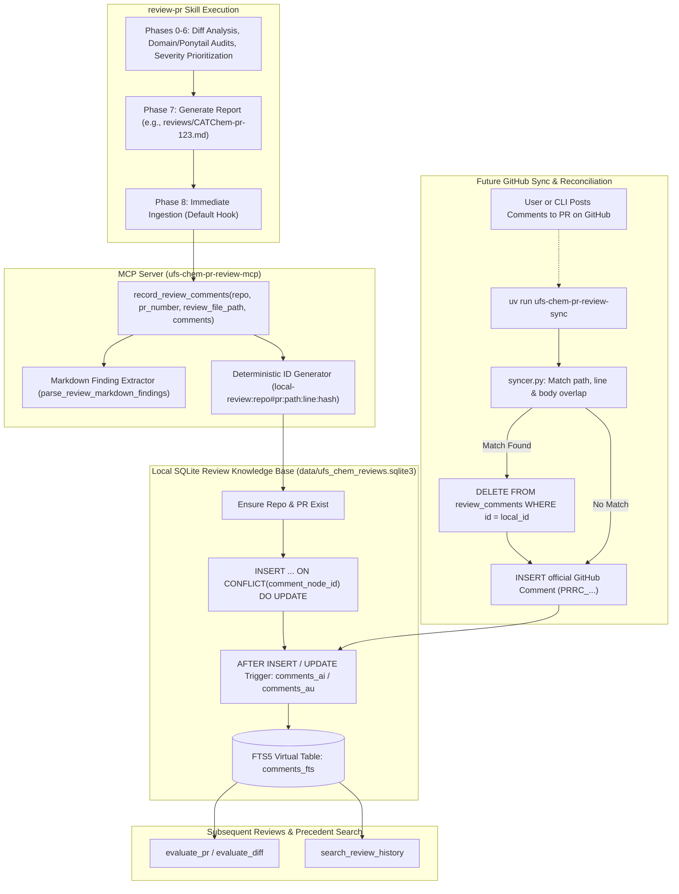

# Feature: Immediate Review Comment Ingestion and Deduplication for Deep-Dive Reviews

Refined 2026-10-23 from `design/feat/20261007-1615-initial-imp/20261023-0948-incorporate-comments-immediately.md`. Extends the `ufs-chem-pr-review-mcp` ecosystem and the `review-pr` workspace skill to immediately ingest all synthesized code review findings, domain evaluations, and Ponytail over-engineering action items into the local historical review database (`data/ufs_chem_reviews.sqlite3`) by default upon completing a deep-dive review. Introduces a new MCP tool `record_review_comments`, a deterministic synthetic node ID hashing scheme (`local-review:<repo>#<pr>:<path>:<line>:<hash>`) providing idempotent updates on re-reviews, automated Markdown report finding extraction, and a lightweight reconciliation mechanism in the sync engine (`syncer.py`) to seamlessly resolve duplicates when locally recorded comments are subsequently submitted to GitHub.

# session

- **Session ID**: `ef7c5abe-c2e3-42e2-858f-d6fa5ea87300`
- **Resume Command**: `agy --resume ef7c5abe-c2e3-42e2-858f-d6fa5ea87300`

## Goal

Transform `ufs-chem-pr-review-mcp` into an immediate, self-enriching continuous learning system by automatically recording findings from deep-dive reviews directly into the local SQLite knowledge base (`data/ufs_chem_reviews.sqlite3`):

1. **Default Post-Review Ingestion in `review-pr` Skill**:
   - As soon as a deep-dive code review finishes and the report is written to disk (Phase 7), the `review-pr` skill automatically collects all actionable findings (P0 Blockers, P1 Majors, P2 Over-Engineering/Ponytail, P3 Nits) and inserts them into `data/ufs_chem_reviews.sqlite3`.
   - FTS5 full-text indexing triggers (`comments_ai`) fire instantaneously, making the findings immediately searchable via `search_review_history` and available as ranked historical precedents (`query_relevant_comments`) for any subsequent review.
   - Eliminates the previous bottleneck where findings remained trapped in ephemeral Markdown files unless manually posted to GitHub and subsequently synchronized via `ufs-chem-pr-review-sync`.

2. **First-Class MCP Tool `record_review_comments`**:
   - Exposes a dedicated endpoint in `src/ufs_chem_pr_review_mcp/server.py` that accepts either structured finding objects or the path to a generated review report file (`reviews/pr-123.md`).
   - Automatically registers repository and pull request parent records if they do not already exist in the database.
   - Maps review findings into standard database categories (`ReviewCategory`), language classifiers (`SupportedLanguage`), and 1-5 criticality ratings.

3. **Deterministic Idempotency & Clean Duplicate Reconciliation**:
   - Generates deterministic synthetic node IDs formatted as `local-review:{repo}#{pr_number}:{path}:{line}:{fingerprint}` where the fingerprint is a truncated SHA-256 hash of the normalized recommendation and category. Re-evaluating the same PR updates existing records in place rather than proliferating duplicate entries (`ON CONFLICT(comment_node_id) DO UPDATE`).
   - Provides a straightforward, low-friction deduplication strategy for when comments are subsequently posted to GitHub: when `ufs-chem-pr-review-sync` runs, the ingestion pipeline checks for local synthetic comments on matching `(pr_id, path, line)` coordinates with overlapping text bodies. It reconciles them by cleanly removing the synthetic local draft so the official GitHub review comment (with its genuine GitHub `comment_node_id`, author login, and diff follow-up tracking) supersedes it with zero duplicate noise.

---

## Pre-design audit (fresh facts, 2026-10-23)

1. **Database Schema & Indexing Architecture (`src/ufs_chem_pr_review_mcp/db/schema.py`)**:
   - The SQLite database resides at `data/ufs_chem_reviews.sqlite3` with `PRAGMA foreign_keys = ON` and `PRAGMA journal_mode = WAL`.
   - Schema defines three relational tables and one FTS5 virtual table:
     - `repositories`: `id`, `name` (UNIQUE), `url`, `default_branch`, `last_synced_at`, `created_at`, `updated_at`.
     - `pull_requests`: `id`, `repo_id`, `pr_number`, `title`, `author_login`, `state`, `base_sha`, `head_sha`, `created_at`, `updated_at`, `merged_at`, `indexed_at`, `UNIQUE(repo_id, pr_number)`.
     - `review_comments`: `id`, `pr_id`, `comment_node_id` (TEXT UNIQUE), `author_login`, `author_association`, `body`, `path`, `line`, `original_line`, `start_line`, `side`, `diff_hunk`, `language`, `category`, `criticality` (1-5), `has_diff_followup` (0/1), `diff_followup_status`, `created_at`, `updated_at`, `indexed_at`.
     - `comments_fts`: FTS5 table indexed on `(body, path, diff_hunk)` with triggers `comments_ai` (AFTER INSERT), `comments_ad` (AFTER DELETE), and `comments_au` (AFTER UPDATE).
   - Any insertion into `review_comments` immediately updates `comments_fts`, making newly inserted comments instantly discoverable by BM25 ranking in `search_review_history` and `query_relevant_comments`.

2. **Data Access Layer (`ReviewDatabase` in `src/ufs_chem_pr_review_mcp/db/repository.py`)**:
   - `insert_review_comment(...)` requires an existing `pull_requests` record matching `(repo_name, pr_number)`. If the PR is missing, it raises `ValueError("Pull request not registered: ...")`.
   - `upsert_pull_request(...)` requires an existing `repositories` record matching `repo_name`. If the repo is missing, it raises `ValueError("Repository not registered: ...")`.
   - `insert_review_comment` relies on `ON CONFLICT(comment_node_id) DO UPDATE SET ...`. If `comment_node_id` is unique and deterministic, SQLite updates the row in place and triggers `comments_au`, keeping FTS5 in sync.
   - Currently, `ReviewDatabase` only supports inserting comments via the GitHub sync pipeline (`syncer.py`). It lacks a high-level API to batch-insert locally synthesized review findings or to reconcile local synthetic records against newly synced GitHub comments.

3. **Current Review Skill Pipeline (`.agents/skills/review-pr/SKILL.md`)**:
   - The skill currently executes a 7-phase autonomous pipeline:
     - Phase 0: Freshness verification & on-demand sync (`uv run ufs-chem-pr-review-sync --repo <target>`).
     - Phase 1: Input validation & output path preparation.
     - Phase 2: Ingestion via `evaluate_pr` MCP tool, live & pending comment pulling, CI checks verification.
     - Phase 3: Live discussion reconciliation & comment validity evaluation (`VALID`, `INVALID`, `OUTDATED`, `PARTIALLY_VALID`).
     - Phase 4: Multi-lens deep dive (Ponytail over-engineering, NOAA OMD standards, atmospheric chemistry physics).
     - Phase 5: Severity prioritization (P0 Blocker, P1 Major, P2 Over-Engineering, P3 Nit).
     - Phase 6: Machine-applicable patches and suggestions (````suggestion```` and `diff` hunks).
     - Phase 7: Output file generation (`reviews/pr-123.md`) and user summary presentation.
   - **Crucial Gap**: Once Phase 7 finishes writing the report to disk, the review workflow terminates. None of the identified findings, invalid comment debunkings, or Ponytail simplifications are written to `data/ufs_chem_reviews.sqlite3`. Future reviews of other PRs in the same repo cannot learn from these findings until the comments are manually posted to GitHub and `ufs-chem-pr-review-sync` is executed.

4. **GitHub Ingestion Engine & Follow-up Tracking (`src/ufs_chem_pr_review_mcp/ingest/syncer.py`)**:
   - `sync_repository(client, db, repo_name, ...)` queries GitHub REST API for all PRs and inline review comments (`client.get_pr_comments`).
   - For every comment, GitHub provides `comment["node_id"]` (e.g. `PRRC_kwDO...`) or `comment["id"]` (e.g. `142857102`).
   - It computes `has_diff_followup` by checking subsequent commit patches against `path` and `line`.
   - It classifies comments into `ReviewCategory` and `criticality` using keyword heuristics in `classifier.py`.
   - If an agent previously recorded a local review comment for the same PR at the same file and line, the incoming GitHub comment will have a completely different `comment_node_id` (`PRRC_...` vs `local-review:...`). Without reconciliation, both rows would coexist in `review_comments`.

5. **Existing FastMCP Tools (`src/ufs_chem_pr_review_mcp/server.py`)**:
   - 6 tools exposed: `evaluate_diff`, `evaluate_pr`, `search_review_history`, `get_repo_review_stats`, `format_review_output`, `generate_patch`.
   - All current tools use `READ_ONLY_ANNOTATIONS = ToolAnnotations(readOnlyHint=True)`.
   - Adding a mutating tool `record_review_comments` requires `readOnlyHint=False` so that MCP client environments correctly understand that database records are being created or updated.

---

## Design

### 0. Decisions

- **Decision 0.1: Default Ingestion in `review-pr` (Phase 8)**:
  - Add Phase 8 ("Immediate Database Ingestion") to `.agents/skills/review-pr/SKILL.md`.
  - By default, after Phase 7 generates the review file, the agent calls `record_review_comments` to persist all generated findings (P0, P1, P2, P3) directly into `data/ufs_chem_reviews.sqlite3`.
  - The review presentation in Phase 7 reports the ingestion result: `Database Ingestion: <N> findings recorded to data/ufs_chem_reviews.sqlite3`.
  - Provide an optional bypass flag (`--no-db-record` or explicit user instruction "do not save to db") to skip ingestion when requested, keeping default behavior frictionless and automatic.

- **Decision 0.2: First-Class MCP Tool `record_review_comments`**:
  - Implement `@mcp.tool(annotations=MUTATING_ANNOTATIONS, ...)` in `src/ufs_chem_pr_review_mcp/server.py`.
  - Accepts flexible input shapes:
    - Structured comment list (`comments: list[LocalReviewCommentInput]`), OR
    - Markdown review file path (`review_file_path: str`), OR
    - Raw markdown text (`markdown_text: str`).
  - Target PR can be specified via `pr_url` (e.g. `https://github.com/ufs-community/CATChem/pull/123`) or via `repo` and `pr_number`.
  - If a file path or raw markdown is provided, the tool automatically parses the findings from Section 4 ("Prioritized Action Items") and Section 5 ("Detailed Findings & Machine-Applicable Suggestions"), extracting severity, location, category, and suggestions.

- **Decision 0.3: Deterministic Synthetic Node ID (`local-review:...`)**:
  - In `review_comments`, `comment_node_id` is unique.
  - For local review comments, construct deterministic IDs:
    `local-review:{owner}/{repo}#{pr_number}:{normalized_path}:{line}:{fingerprint}`
    where `fingerprint` is the first 12 characters of SHA-256 over `f"{category}:{body.strip()}"`.
  - If line is omitted, use `0`.
  - When the agent re-runs a review on the same PR, any unchanged finding produces the exact same `comment_node_id`. SQLite updates the record in place via `ON CONFLICT(comment_node_id) DO UPDATE`, maintaining strict idempotency.

- **Decision 0.4: Lightweight Deduplication & Reconciliation on GitHub Sync**:
  - Address duplicate handling with a clean, low-overhead mechanism adhering to Ponytail simplicity (no complex distributed ID coordination):
    1. During `syncer.py` sync, before inserting a newly retrieved GitHub comment `gh_comment` for PR `pr_id`, query existing local review comments for that PR:
       ```sql
       SELECT id, comment_node_id, body FROM review_comments
       WHERE pr_id = ? AND path = ? AND (line = ? OR line IS NULL) AND comment_node_id LIKE 'local-review:%';
       ```
    2. If a local comment matches on `path` and `line`, and shares substantial text overlap with the GitHub comment (e.g. exact body match, shared code suggestion block, or token overlap > 70%), invoke `ReviewDatabase.reconcile_local_comment(conn, local_comment_id)`.
    3. The reconciliation deletes the `local-review:...` row.
    4. The SQLite `comments_ad` trigger fires and cleans up the old FTS5 entry in `comments_fts`.
    5. The incoming official GitHub comment is then inserted with its real `PRRC_...` node ID, author login, timestamp, and diff follow-up status.
    6. If a local comment is never posted to GitHub, it remains permanently in `review_comments` as a valid historical review precedent.
    7. If only a subset of comments are posted to GitHub, only the posted subset is reconciled; the rest remain stored locally.

- **Decision 0.5: Automatic Parent Record Provisioning**:
  - When `record_review_comments` runs on a PR that has not yet been synced by `ufs-chem-pr-review-sync`:
    - Ensure repository exists via `db.upsert_repository(repo_name, repo_url)`.
    - Ensure pull request exists via `db.upsert_pull_request(...)`.
    - If GitHub API is accessible, fetch basic PR title and author; if offline or unauthenticated, record placeholder metadata (`title="PR #{pr_number}"`, `author_login="unknown"`, `base_sha="unknown"`, `head_sha="unknown"`), which will be automatically enriched whenever `sync` is executed.

- **Decision 0.6: Explicit Pydantic Typing & No `Any`**:
  - Define new models in `src/ufs_chem_pr_review_mcp/models/local_review.py`:
    - `LocalReviewCommentInput`
    - `RecordReviewCommentsInput`
    - `RecordReviewCommentsResponse`
    - `ReconciliationStats`
  - Every field includes `Field(description="...")`.
  - Public method signatures use concrete types: `str`, `int`, `list[LocalReviewCommentInput]`, `dict[str, str]`, avoiding `Any`.

- **Decision 0.7: Priority Notation Across System Layers (Blocker, Major, Moderate, Minor)**:
  - Explicitly preserve and note the finding priority across all 4 layers of the review and storage pipeline:
    1. **Domain Severity Tiers & Labels**:
       - `P0_BLOCKER`: Priority label `"Blocker"`, database `criticality = 5` — Severe defects, numerical instabilities, invalid physics (e.g. molar vs mass mixing ratios), crashes, ESMF deadlocks, or broken test harnesses.
       - `P1_MAJOR`: Priority label `"Major"`, database `criticality = 4` — Algorithmic bugs, resource leaks, missing allocation status checks (`stat=rc, errmsg=msg`), OpenMP race conditions, or breaking interface contracts.
       - `P2_MODERATE`: Priority label `"Moderate"` (including Ponytail over-engineering), database `criticality = 3` — Redundant wrapper abstractions, dead code, YAGNI constructs, or non-standard Fortran kinds.
       - `P3_MINOR`: Priority label `"Minor"` (or Nit), database `criticality = 1` — Formatting irregularities, documentation typos, or script warning text.
    2. **SQLite Column Storage**: Preserved as integer `criticality` (1 to 5) in `review_comments`, enabling structured queries (e.g. `min_criticality >= 4` for blockers/majors in `search_review_history` and `query_relevant_comments`).
    3. **Comment Body Prefix & FTS5 Full-Text Indexing**: Standardized prefix `**[P{N} - {Label}]** <Title>` (e.g., `**[P0 - Blocker]** Numerical Instability...`) ensures priority is prominently displayed to human readers and indexed by SQLite FTS5 for queries like `search_review_history("Blocker chemistry")` or `search_review_history("P0")`.
    4. **Model Serialization & Tool Output**: `FindingSeverity` exposes `.label` and `.default_criticality`. `RecordedCommentSummary` returns both `severity: FindingSeverity` (e.g. `P0`), `priority_label: str` (e.g. `"Blocker"`), and `criticality: int` (e.g. `5`).

---

### 1. Architecture & Data Flow



---

### 2. Data Models & Schemas (`src/ufs_chem_pr_review_mcp/models/local_review.py`)

All models inherit from Pydantic v2 `BaseModel` with frozen configuration, forbidden extra fields, and comprehensive descriptions on every field.

```python
"""Pydantic schemas for recording local review comments and managing reconciliation."""

from enum import Enum
from pydantic import BaseModel, ConfigDict, Field, model_validator
from ufs_chem_pr_review_mcp.models.common import ReviewCategory, SupportedLanguage


class FindingSeverity(str, Enum):
    """Review finding severity levels matching review-pr skill standard."""

    P0_BLOCKER = "P0"
    P1_MAJOR = "P1"
    P2_MODERATE = "P2"
    P3_MINOR = "P3"

    @property
    def label(self) -> str:
        """Human-readable priority label."""
        labels = {
            FindingSeverity.P0_BLOCKER: "Blocker",
            FindingSeverity.P1_MAJOR: "Major",
            FindingSeverity.P2_MODERATE: "Moderate",
            FindingSeverity.P3_MINOR: "Minor",
        }
        return labels[self]

    @property
    def default_criticality(self) -> int:
        """Map severity level to database criticality integer (1 to 5)."""
        mapping = {
            FindingSeverity.P0_BLOCKER: 5,
            FindingSeverity.P1_MAJOR: 4,
            FindingSeverity.P2_MODERATE: 3,
            FindingSeverity.P3_MINOR: 1,
        }
        return mapping[self]


class LocalReviewCommentInput(BaseModel):
    """Input payload for a single review comment synthesized by the deep-dive review assistant."""

    model_config = ConfigDict(frozen=True, extra="forbid")

    path: str = Field(
        description="Relative file path within the repository where the finding applies"
    )
    line: int | None = Field(
        default=None,
        ge=1,
        description="Line number in the new code (None for top-level or file-level comment)",
    )
    start_line: int | None = Field(
        default=None,
        ge=1,
        description="Starting line number for multi-line comment ranges",
    )
    body: str = Field(
        description="Markdown text of the review comment explaining the issue, rationale, and recommendation"
    )
    category: ReviewCategory = Field(
        default=ReviewCategory.CORRECTNESS,
        description="Review taxonomy category (e.g. physics_chemistry, over_engineering, style_standards, performance)",
    )
    severity: FindingSeverity = Field(
        default=FindingSeverity.P2_MODERATE,
        description="Prioritized severity ranking: P0 (Blocker), P1 (Major), P2 (Moderate/Ponytail), P3 (Nit)",
    )
    criticality: int | None = Field(
        default=None,
        ge=1,
        le=5,
        description="Explicit criticality (1-5). If None, inferred automatically from severity tier",
    )
    language: SupportedLanguage = Field(
        default=SupportedLanguage.UNKNOWN,
        description="Programming language of the target file (Fortran, C++, Python, Bash, etc.)",
    )
    diff_hunk: str | None = Field(
        default=None,
        description="Relevant unified diff hunk context associated with this comment",
    )
    suggested_change: str | None = Field(
        default=None,
        description="Exact replacement code snippet suitable for a GitHub suggestion block",
    )
    author_login: str = Field(
        default="antigravity-review",
        description="Author attribution for the comment (e.g. 'antigravity-review', 'user')",
    )

    def resolved_criticality(self) -> int:
        """Return explicit criticality or fall back to severity mapping."""
        return (
            self.criticality
            if self.criticality is not None
            else self.severity.default_criticality
        )


class RecordReviewCommentsInput(BaseModel):
    """Input payload for record_review_comments MCP tool."""

    model_config = ConfigDict(frozen=True, extra="forbid")

    repo: str | None = Field(
        default=None,
        description="Target repository in owner/repo format, e.g. 'ufs-community/CATChem'",
    )
    pr_number: int | None = Field(
        default=None,
        ge=1,
        description="Pull request number",
    )
    pr_url: str | None = Field(
        default=None,
        description="Full GitHub PR URL (e.g. 'https://github.com/ufs-community/CATChem/pull/123')",
    )
    comments: list[LocalReviewCommentInput] = Field(
        default_factory=list,
        description="List of structured review comments to insert",
    )
    review_file_path: str | None = Field(
        default=None,
        description="Path to a markdown review report file from which findings will be extracted automatically",
    )
    markdown_text: str | None = Field(
        default=None,
        description="Raw markdown review report content from which findings will be extracted automatically",
    )
    source_tag: str = Field(
        default="agent-deep-dive",
        description="Source identifier tag indicating review provenance",
    )

    @model_validator(mode="after")
    def validate_inputs(self) -> "RecordReviewCommentsInput":
        if not self.pr_url and not (self.repo and self.pr_number):
            raise ValueError("Must provide either pr_url or both repo and pr_number.")
        if not self.comments and not self.review_file_path and not self.markdown_text:
            raise ValueError(
                "Must provide at least one of: comments, review_file_path, or markdown_text."
            )
        return self


class RecordedCommentSummary(BaseModel):
    """Summary of an individual comment recorded in the database."""

    model_config = ConfigDict(frozen=True, extra="forbid")

    comment_node_id: str = Field(description="Deterministic synthetic node ID")
    path: str = Field(description="File path of the finding")
    line: int | None = Field(default=None, description="Line number of the finding")
    category: ReviewCategory = Field(description="Assigned category")
    severity: FindingSeverity = Field(
        description="Assigned severity tier (P0, P1, P2, P3)"
    )
    priority_label: str = Field(
        description="Human-readable priority label: Blocker, Major, Moderate, Minor"
    )
    criticality: int = Field(description="Assigned criticality score (1-5)")
    status: str = Field(description="'inserted' or 'updated'")


class RecordReviewCommentsResponse(BaseModel):
    """Output confirmation payload from record_review_comments tool."""

    model_config = ConfigDict(frozen=True, extra="forbid")

    repo: str = Field(description="Target repository evaluated")
    pr_number: int = Field(description="Target PR number")
    total_received: int = Field(
        description="Total candidate findings parsed or received"
    )
    inserted_count: int = Field(
        description="Number of new comments inserted into database"
    )
    updated_count: int = Field(
        description="Number of existing comments updated in place"
    )
    db_path: str = Field(description="Absolute path to the SQLite review database")
    recorded_comments: list[RecordedCommentSummary] = Field(
        default_factory=list,
        description="List of recorded comments and their synthetic node IDs",
    )


class ReconciliationStats(BaseModel):
    """Statistics summarizing reconciliation between local synthetic comments and incoming GitHub comments."""

    model_config = ConfigDict(frozen=True, extra="forbid")

    repo: str = Field(description="Repository reconciled")
    pr_number: int = Field(description="PR number reconciled")
    local_comments_found: int = Field(
        description="Total local synthetic comments present before sync"
    )
    reconciled_count: int = Field(
        description="Count of local synthetic comments superseded by official GitHub comments"
    )
    retained_local_count: int = Field(
        description="Count of local comments retained (unposted on GitHub)"
    )
```

---

### 3. Database Layer Extensions (`src/ufs_chem_pr_review_mcp/db/repository.py`)

Add the following dedicated methods to `ReviewDatabase`:

#### 3.1 Generating Deterministic Synthetic Node IDs
```python
def generate_synthetic_node_id(
    repo_name: str,
    pr_number: int,
    path: str,
    line: int | None,
    category: str,
    body: str,
) -> str:
    """Generate a deterministic synthetic comment_node_id for a local review finding.

    Format: local-review:{repo}#{pr_number}:{path}:{line}:{fingerprint}
    where fingerprint is a 12-character SHA-256 hex digest of category and body.
    """
    norm_path = path.strip().replace("\\", "/")
    norm_line = str(line) if line is not None else "0"
    content_key = f"{category}:{body.strip()}".encode("utf-8")
    fingerprint = hashlib.sha256(content_key).hexdigest()[:12]
    return f"local-review:{repo_name}#{pr_number}:{norm_path}:{norm_line}:{fingerprint}"
```

#### 3.2 Recording Local Review Comments Batch
```python
def record_local_review_comments(
    self,
    repo_name: str,
    pr_number: int,
    comments: list[LocalReviewCommentInput],
    repo_url: str | None = None,
    pr_title: str | None = None,
    author_login: str = "unknown",
) -> tuple[int, int, list[RecordedCommentSummary]]:
    """Record locally synthesized review comments into SQLite.

    Ensures repository and pull request parent records exist, generates deterministic
    synthetic node IDs, and executes upsert into review_comments.

    Returns:
        tuple of (inserted_count, updated_count, list of RecordedCommentSummary)
    """
    conn = self.get_connection()
    try:
        # 1. Ensure repository exists
        cursor = conn.cursor()
        cursor.execute("SELECT id FROM repositories WHERE name = ?;", (repo_name,))
        repo_row = cursor.fetchone()
        if not repo_row:
            url = repo_url or f"https://github.com/{repo_name}"
            now = datetime.now(timezone.utc).isoformat()
            cursor.execute(
                """
                INSERT INTO repositories (name, url, default_branch, created_at, updated_at)
                VALUES (?, ?, 'main', ?, ?)
                RETURNING id;
                """,
                (repo_name, url, now, now),
            )
            repo_id = cursor.fetchone()["id"]
        else:
            repo_id = repo_row["id"]

        # 2. Ensure pull request exists
        cursor.execute(
            "SELECT id FROM pull_requests WHERE repo_id = ? AND pr_number = ?;",
            (repo_id, pr_number),
        )
        pr_row = cursor.fetchone()
        now = datetime.now(timezone.utc).isoformat()
        if not pr_row:
            title = pr_title or f"PR #{pr_number}"
            cursor.execute(
                """
                INSERT INTO pull_requests (
                    repo_id, pr_number, title, author_login, state,
                    base_sha, head_sha, created_at, updated_at, indexed_at
                )
                VALUES (?, ?, ?, ?, 'open', 'unknown', 'unknown', ?, ?, ?)
                RETURNING id;
                """,
                (repo_id, pr_number, title, author_login, now, now, now),
            )
            pr_id = cursor.fetchone()["id"]
        else:
            pr_id = pr_row["id"]

        # 3. Insert or update comments
        inserted_count = 0
        updated_count = 0
        summaries: list[RecordedCommentSummary] = []

        for c in comments:
            lang = (
                c.language
                if c.language != SupportedLanguage.UNKNOWN
                else detect_language(c.path)
            )
            crit = c.resolved_criticality()
            node_id = generate_synthetic_node_id(
                repo_name=repo_name,
                pr_number=pr_number,
                path=c.path,
                line=c.line,
                category=c.category.value,
                body=c.body,
            )

            # Check if record already exists
            cursor.execute(
                "SELECT id FROM review_comments WHERE comment_node_id = ?;", (node_id,)
            )
            existing = cursor.fetchone()

            rendered_body = c.body
            if c.suggested_change:
                suggestion_block = (
                    f"\n\n```suggestion\n{c.suggested_change.rstrip()}\n```"
                )
                if suggestion_block not in rendered_body:
                    rendered_body = f"{rendered_body.rstrip()}{suggestion_block}"

            cursor.execute(
                """
                INSERT INTO review_comments (
                    pr_id, comment_node_id, author_login, author_association,
                    body, path, line, original_line, start_line, side, diff_hunk,
                    language, category, criticality, has_diff_followup,
                    diff_followup_status, created_at, updated_at, indexed_at
                )
                VALUES (?, ?, ?, 'REVIEWER', ?, ?, ?, ?, ?, 'RIGHT', ?, ?, ?, ?, 0, 'UNKNOWN', ?, ?, ?)
                ON CONFLICT(comment_node_id) DO UPDATE SET
                    body = excluded.body,
                    line = excluded.line,
                    start_line = excluded.start_line,
                    criticality = excluded.criticality,
                    updated_at = excluded.updated_at,
                    indexed_at = excluded.indexed_at;
                """,
                (
                    pr_id,
                    node_id,
                    c.author_login,
                    rendered_body,
                    c.path,
                    c.line,
                    c.line,
                    c.start_line,
                    c.diff_hunk,
                    lang.value,
                    c.category.value,
                    crit,
                    now,
                    now,
                    now,
                ),
            )

            status = "updated" if existing else "inserted"
            if existing:
                updated_count += 1
            else:
                inserted_count += 1

            summaries.append(
                RecordedCommentSummary(
                    comment_node_id=node_id,
                    path=c.path,
                    line=c.line,
                    category=c.category,
                    severity=c.severity,
                    priority_label=c.severity.label,
                    criticality=crit,
                    status=status,
                )
            )

        conn.commit()
        return inserted_count, updated_count, summaries
    finally:
        conn.close()
```

#### 3.3 Reconciling Local Comments on GitHub Sync
```python
def reconcile_local_comments_for_pr(
    self,
    repo_name: str,
    pr_number: int,
    incoming_gh_comments: list[dict[str, Any]],
) -> ReconciliationStats:
    """Reconcile local synthetic review comments when real comments are fetched from GitHub.

    For any incoming GitHub comment matching a local synthetic comment on path and line
    with overlapping text or suggestion content, the local synthetic comment is deleted
    so the authoritative GitHub comment supersedes it.
    """
    conn = self.get_connection()
    try:
        cursor = conn.cursor()
        cursor.execute(
            """
            SELECT rc.id, rc.comment_node_id, rc.path, rc.line, rc.body
            FROM review_comments rc
            JOIN pull_requests pr ON rc.pr_id = pr.id
            JOIN repositories r ON pr.repo_id = r.id
            WHERE r.name = ? AND pr.pr_number = ? AND rc.comment_node_id LIKE 'local-review:%';
            """,
            (repo_name, pr_number),
        )
        local_rows = cursor.fetchall()
        if not local_rows:
            return ReconciliationStats(
                repo=repo_name,
                pr_number=pr_number,
                local_comments_found=0,
                reconciled_count=0,
                retained_local_count=0,
            )

        reconciled_ids: set[int] = set()

        for gh_c in incoming_gh_comments:
            gh_path = gh_c.get("path")
            gh_line = gh_c.get("line") or gh_c.get("original_line")
            gh_body = (gh_c.get("body") or "").strip()

            for lr in local_rows:
                lr_id = int(lr["id"])
                if lr_id in reconciled_ids:
                    continue

                lr_path = lr["path"]
                lr_line = lr["line"]
                lr_body = (lr["body"] or "").strip()

                # Coordinate match check
                if lr_path == gh_path and (lr_line == gh_line or lr_line is None):
                    # Check text overlap / semantic match
                    if _is_comment_text_match(lr_body, gh_body):
                        reconciled_ids.add(lr_id)

        # Delete reconciled local comments (triggers comments_ad to clean up FTS5)
        for rid in reconciled_ids:
            cursor.execute("DELETE FROM review_comments WHERE id = ?;", (rid,))

        conn.commit()
        return ReconciliationStats(
            repo=repo_name,
            pr_number=pr_number,
            local_comments_found=len(local_rows),
            reconciled_count=len(reconciled_ids),
            retained_local_count=len(local_rows) - len(reconciled_ids),
        )
    finally:
        conn.close()


def _is_comment_text_match(local_body: str, gh_body: str) -> bool:
    """Deterministic heuristic to verify if a GitHub comment matches a local review comment."""
    if not local_body or not gh_body:
        return False
    # Exact match
    if local_body == gh_body:
        return True
    # If one contains the other (e.g. suggestion block wrapped or preamble added)
    if local_body in gh_body or gh_body in local_body:
        return True
    # Token jaccard similarity check on non-trivial words (>3 chars)
    t_local = set(re.findall(r"[a-zA-Z0-9_]{3,}", local_body.lower()))
    t_gh = set(re.findall(r"[a-zA-Z0-9_]{3,}", gh_body.lower()))
    if not t_local or not t_gh:
        return False
    overlap = len(t_local & t_gh) / min(len(t_local), len(t_gh))
    return overlap >= 0.65
```

---

### 4. Markdown Review Report Parser (`src/ufs_chem_pr_review_mcp/models/local_review.py`)

To make ingestion completely effortless for the agent, implement `parse_review_markdown_findings`:

```python
def parse_review_markdown_findings(markdown_text: str) -> list[LocalReviewCommentInput]:
    """Parse prioritized findings and suggestions from a review-pr markdown report.

    Extracts:
    - Section 4 items: - [ ] **[P0]** <summary> — [path:line](...)
    - Section 5 items: ### [P0] Title, Location, Problem, Rationale, ```suggestion``` blocks.
    - Categorizes severity, maps file path, extracts line numbers, and builds structured comments.
    """
    comments: list[LocalReviewCommentInput] = []

    # Regex matching Section 5 finding blocks:
    # ### [P0|P1|P2|P3] <Title>
    # - **Location**: [path#L123](...) or `path:123`
    # - **Problem**: ...
    # - **Rationale**: ...
    # Optional 1-click suggestion block
    pattern = re.compile(
        r"###\s*\[(P[0-3])\]\s*([^\n]+)\n"
        r"(?:.*?- \*\*Location\*\*:\s*\[?([^:\n\]]+)(?::|#L)?(\d+)?\]?[^\n]*\n)?"
        r"(.*?)(?=(?:\n###\s*\[P[0-3]\]|\n##\s|\Z))",
        re.DOTALL,
    )

    for m in pattern.finditer(markdown_text):
        sev_str, title, raw_path, raw_line, content = m.groups()
        severity = FindingSeverity(sev_str)
        path = (
            raw_path.strip().replace("file://", "").split("#")[0].strip()
            if raw_path
            else "unknown"
        )
        line = int(raw_line) if raw_line else None

        # Extract suggestion block if present
        sugg_match = re.search(r"```suggestion\n(.*?)\n```", content, re.DOTALL)
        suggested_change = sugg_match.group(1) if sugg_match else None

        # Detect category based on title & content keywords
        category = _infer_finding_category(title, content)
        lang = detect_language(path)

        body = f"**[{severity.value} - {severity.label}] {title.strip()}**\n\n{content.strip()}"
        comments.append(
            LocalReviewCommentInput(
                path=path,
                line=line,
                body=body,
                category=category,
                severity=severity,
                language=lang,
                suggested_change=suggested_change,
                author_login="antigravity-review",
            )
        )

    return comments


def _infer_finding_category(title: str, content: str) -> ReviewCategory:
    """Infer ReviewCategory from finding title and text content."""
    combined = f"{title} {content}".lower()
    if any(
        k in combined
        for k in [
            "chemistry",
            "molar",
            "mixing ratio",
            "reaction",
            "photolysis",
            "emission",
        ]
    ):
        return ReviewCategory.PHYSICS_CHEMISTRY
    if any(
        k in combined
        for k in ["ponytail", "yagni", "dead code", "removable", "shrink", "delete"]
    ):
        return ReviewCategory.OVER_ENGINEERING
    if any(
        k in combined
        for k in ["kind", "standard", "pure", "openmp", "raii", "formatting", "flang"]
    ):
        return ReviewCategory.STYLE_STANDARDS
    if any(
        k in combined
        for k in [
            "leak",
            "allocation",
            "stat=",
            "errmsg",
            "esmf_log",
            "crash",
            "segfault",
        ]
    ):
        return ReviewCategory.CORRECTNESS
    return ReviewCategory.CORRECTNESS
```

---

### 5. FastMCP Server Endpoint (`src/ufs_chem_pr_review_mcp/server.py`)

Add the mutating tool `record_review_comments` to `server.py`:

```python
MUTATING_ANNOTATIONS = ToolAnnotations(readOnlyHint=False)


# 7. record_review_comments
@mcp.tool(
    annotations=MUTATING_ANNOTATIONS,
    description="Immediately records code review comments and findings into the local review database (data/ufs_chem_reviews.sqlite3). Accepts structured findings or a markdown review report file path.",
)
def record_review_comments(
    repo: str | None = None,
    pr_number: int | None = None,
    pr_url: str | None = None,
    comments: list[dict[str, Any]] | None = None,
    review_file_path: str | None = None,
    markdown_text: str | None = None,
    source_tag: str = "agent-deep-dive",
) -> str:
    # Resolve target repo and pr_number
    if pr_url:
        try:
            comp = parse_github_pr_url(pr_url)
            target_repo = comp.full_repo
            target_pr = comp.pr_number
        except ValueError as e:
            return json.dumps({"error": str(e), "message": "Invalid pr_url provided."})
    elif repo and pr_number:
        target_repo = repo
        target_pr = pr_number
    else:
        return json.dumps(
            {
                "error": "Missing target",
                "message": "Must provide pr_url or both repo and pr_number.",
            }
        )

    # Gather candidate findings
    parsed_comments: list[LocalReviewCommentInput] = []

    # 1. Directly supplied comments
    if comments:
        for c in comments:
            parsed_comments.append(LocalReviewCommentInput.model_validate(c))

    # 2. Extract from markdown file
    if review_file_path:
        fpath = Path(review_file_path)
        if fpath.exists():
            text = fpath.read_text(encoding="utf-8")
            parsed_comments.extend(parse_review_markdown_findings(text))
        else:
            logger.warning(f"review_file_path does not exist: {review_file_path}")

    # 3. Extract from raw markdown text
    if markdown_text:
        parsed_comments.extend(parse_review_markdown_findings(markdown_text))

    if not parsed_comments:
        return json.dumps(
            {
                "error": "No findings found",
                "message": "No comments provided and no findings could be parsed from markdown.",
            }
        )

    inserted, updated, summaries = db.record_local_review_comments(
        repo_name=target_repo,
        pr_number=target_pr,
        comments=parsed_comments,
    )

    response = RecordReviewCommentsResponse(
        repo=target_repo,
        pr_number=target_pr,
        total_received=len(parsed_comments),
        inserted_count=inserted,
        updated_count=updated,
        db_path=str(db.db_path),
        recorded_comments=summaries,
    )
    return response.model_dump_json(indent=2)
```

---

### 6. Workspace Skill Update: `review-pr` Runbook (`.agents/skills/review-pr/SKILL.md`)

Update `.agents/skills/review-pr/SKILL.md` to add Phase 8 directly after Phase 7:

```markdown
### Phase 8: Immediate Database Ingestion (Default Hook)
Immediately after generating the review report and presenting it to the user, the agent automatically persists all actionable review findings into the historical review database:

1. **Invoke `record_review_comments`**:
   Call the `record_review_comments` tool on the `ufs-chem-pr-review` MCP server:
   - Arguments:
     ```json
     {
       "pr_url": "<pr_url>",
       "review_file_path": "<target_file_path>"
     }
     ```
2. **Under the Hood Execution**:
   - The MCP tool parses all P0, P1, P2, and P3 findings and suggestions directly from the report file.
   - Computes deterministic synthetic node IDs (`local-review:<repo>#<pr>:<path>:<line>:<hash>`).
   - Inserts or updates the findings into `data/ufs_chem_reviews.sqlite3`.
   - SQLite FTS5 trigger `comments_ai` immediately indexes the findings into `comments_fts`.
3. **Report Database Confirmation to User**:
   Include the ingestion count in the conversational summary:
   - `Indexed Findings`: `<N>` comments added to local review database (`data/ufs_chem_reviews.sqlite3`).
   - `Instant Precedent Availability`: These findings are now immediately discoverable via `search_review_history` and will be ranked in subsequent reviews of other PRs.
```

---

### 7. Deduplication & Reconciliation Mechanics

| Scenario | Behavior & Mechanics | Result |
| :--- | :--- | :--- |
| **Re-running Review on Same PR** | The agent re-runs `review-pr` on PR 123. Findings generate identical deterministic synthetic node IDs (`local-review:repo#123:path:line:hash`). SQLite executes `ON CONFLICT(comment_node_id) DO UPDATE SET body=excluded.body...`. | **Zero Duplication**: Record is refreshed in place. `comments_au` trigger updates FTS5 table cleanly. |
| **Reviewing with Additional Findings** | The agent adds a new finding on a different line or a revised finding. New line/hash produces a distinct synthetic ID. | **Accurate Growth**: Existing findings remain; new finding is inserted. |
| **Comments Subsequently Posted to GitHub & Synced** | User or automated tool posts findings to GitHub. Later, `uv run ufs-chem-pr-review-sync` runs. `reconcile_local_comments_for_pr` matches path, line, and body overlap (>65%). It deletes the local synthetic row (`comments_ad` cleans FTS) and inserts the official GitHub comment (`PRRC_...`). | **Seamless Promotion**: Local draft smoothly upgrades to authoritative GitHub comment. Zero duplicates in search or review history. |
| **Partial Comment Posting** | User posts only 2 out of 5 findings to GitHub. When synced, only the 2 matching findings are reconciled and replaced by GitHub comments. | **Preserved Context**: The 3 unposted findings remain stored in the local database, continuing to serve as useful internal precedents. |
| **Comments Never Posted to GitHub** | PR is reviewed internally, closed, or merged without posting comments to GitHub. | **Permanent Knowledge**: All findings remain indexed in `data/ufs_chem_reviews.sqlite3`, preventing repetitive re-discovery of known pitfalls on future PRs. |

---

### 8. Edge Cases & Resilience

1. **Target Repository Not Yet in `repositories` Table**:
   - Handled: `record_local_review_comments` automatically performs `INSERT INTO repositories ... ON CONFLICT(name) DO NOTHING`, ensuring foreign key constraints pass without requiring prior manual sync.
2. **Target PR Not Yet in `pull_requests` Table**:
   - Handled: Automatically inserts a stub PR record (`title="PR #{pr_number}"`, `state="open"`, `base_sha="unknown"`) if not found. When `ufs-chem-pr-review-sync` later syncs the repo, GitHub's authoritative metadata overwrites the stub via `ON CONFLICT(repo_id, pr_number) DO UPDATE`.
3. **Malformed or Custom Markdown Structure**:
   - Handled: `parse_review_markdown_findings` uses regex matching with fallback defaults. If regex finds zero matches (e.g. customized document structure), the tool returns a clean error informing the caller, allowing structured `comments` list to be passed directly.
4. **Multiple Findings on the Exact Same File and Line**:
   - Handled: The synthetic node ID includes a 12-char SHA-256 fingerprint of the normalized finding text and category: `local-review:repo#pr:path:line:fingerprint`. Two different issues on the same line (e.g., P1 missing allocation check and P2 dead code deletion) generate unique node IDs and both coexist cleanly in the database.
5. **Concurrent Database Locks (WAL Mode)**:
   - Handled: The database is opened with `PRAGMA journal_mode = WAL;`, allowing concurrent readers during `search_review_history` while `record_review_comments` writes. Connection is cleanly committed and closed in `finally` blocks.
6. **Rate-Limited GitHub API**:
   - Handled: `record_review_comments` does not call the GitHub API. It operates entirely locally on SQLite, guaranteeing 100% offline availability and zero dependency on GitHub API quotas.

---

### 9. Implementation Plan (Red-Green-Refactor)

#### Phase 1: Models & Schemas (TDD Red -> Green)
1. Write unit tests in `tests/test_local_review_models.py` verifying:
   - `FindingSeverity` to criticality mapping.
   - `LocalReviewCommentInput` validation and default values.
   - `RecordReviewCommentsInput` validator requiring PR target and comment source.
   - `RecordReviewCommentsResponse` serialization.
2. Implement `src/ufs_chem_pr_review_mcp/models/local_review.py`.
3. Run `pytest tests/test_local_review_models.py` to confirm 100% pass.

#### Phase 2: Markdown Parsing & Deterministic Node ID (TDD Red -> Green)
1. Write unit tests in `tests/test_local_review_parser.py`:
   - Test synthetic node ID generation with same inputs -> identical ID.
   - Test synthetic node ID generation with different bodies on same line -> distinct IDs.
   - Test parsing standard review report Markdown with P0, P1, P2, P3 sections, extracting locations, suggestions, and categories.
2. Implement `generate_synthetic_node_id` and `parse_review_markdown_findings` in `models/local_review.py`.
3. Verify all tests pass.

#### Phase 3: Database Layer Upsert & Reconciliation (TDD Red -> Green)
1. Write database integration tests in `tests/test_db_local_reviews.py`:
   - Test `record_local_review_comments` creates repo and PR records if missing.
   - Test inserting 3 comments, verifying `review_comments` rows and FTS5 searchability via `search_review_comments`.
   - Test idempotency: calling `record_local_review_comments` a second time updates existing rows without increasing row count.
   - Test `reconcile_local_comments_for_pr`: insert local comment, simulate incoming GitHub comment with matching path/line/body, confirm local synthetic row is deleted and FTS5 is updated.
2. Implement `record_local_review_comments`, `reconcile_local_comments_for_pr`, and `_is_comment_text_match` in `src/ufs_chem_pr_review_mcp/db/repository.py`.
3. Update `src/ufs_chem_pr_review_mcp/ingest/syncer.py` to call `reconcile_local_comments_for_pr` during PR sync.
4. Verify all tests pass.

#### Phase 4: FastMCP Tool Integration (TDD Red -> Green)
1. Write MCP tool tests in `tests/test_mcp_record_tool.py`:
   - Test `record_review_comments` with `pr_url` and explicit `comments` list.
   - Test `record_review_comments` with `review_file_path` pointing to a test markdown report.
   - Test error handling for missing arguments or invalid URLs.
2. Add `@mcp.tool(annotations=MUTATING_ANNOTATIONS, ...) record_review_comments` in `src/ufs_chem_pr_review_mcp/server.py`.
3. Verify all tests pass.

#### Phase 5: Workspace Skill Update
1. Update `.agents/skills/review-pr/SKILL.md`:
   - Add Phase 8 for automatic database ingestion by default.
   - Update skill description frontmatter and output presentation guidelines.

#### Phase 6: Full Suite Verification & Quality Gates
1. Run full test suite: `uv run pytest --cov=src/ufs_chem_pr_review_mcp --cov-fail-under=100`.
2. Run linter and type checker: `uv run ruff check src tests` and `uv run mypy src tests`.

---

## Verification

| Verification Target | Command / Check | Expected Result |
| :--- | :--- | :--- |
| **Local Review Models** | `pytest tests/test_local_review_models.py` | 100% pass covering all fields, validators, and severity mappings |
| **Markdown Finding Parser** | `pytest tests/test_local_review_parser.py` | Correctly extracts P0-P3 findings, line coordinates, and code suggestions from Markdown |
| **Deterministic Node ID** | `pytest tests/test_local_review_parser.py -k test_synthetic_node_id` | Identical inputs produce identical IDs; different bodies produce distinct IDs |
| **Database Upsert & FTS5** | `pytest tests/test_db_local_reviews.py -k test_upsert_and_fts` | Comments immediately indexed into `comments_fts`; searchable via FTS5 MATCH |
| **Idempotency** | `pytest tests/test_db_local_reviews.py -k test_idempotent_upsert` | Re-recording identical comments updates existing rows without duplicating |
| **Reconciliation on Sync** | `pytest tests/test_db_local_reviews.py -k test_reconciliation_on_sync` | Synced GitHub comments cleanly supersede matching local synthetic comments |
| **MCP Tool `record_review_comments`** | `pytest tests/test_mcp_record_tool.py` | Successfully accepts `pr_url` and `review_file_path`, returning valid JSON confirmation |
| **`review-pr` Skill Runbook** | Inspect `.agents/skills/review-pr/SKILL.md` | Contains Phase 8 default ingestion instructions and user summary guidelines |
| **Code Style & Typing** | `uv run ruff check src tests` & `uv run mypy src tests` | Clean exit with 0 errors or warnings, zero untyped `Any` |
| **Coverage** | `pytest --cov=src/ufs_chem_pr_review_mcp --cov-fail-under=100` | 100.00% statement coverage across all units |

---

## Risks and notes

- **Risk**: A finding extracted from markdown might have no explicit line number if the report refers to a file-level issue.
  - **Mitigation**: `LocalReviewCommentInput.line` is optional (`int | None`). When line is `None`, synthetic node ID uses line coordinate `0`, allowing whole-file architectural and Ponytail findings to be stored and indexed cleanly.
- **Risk**: GitHub sync might delete a local comment if it loosely matches a completely different GitHub comment.
  - **Mitigation**: The reconciliation check requires both exact file path match, line number match (or file-level match), AND a high textual overlap score (>65% token jaccard or substring inclusion). Ambiguous comments are safely retained.
- **Risk**: Review report formatting could vary if an LLM formats Section 5 slightly differently.
  - **Mitigation**: The parser supports both Section 4 action items (`- [ ] **[P0]** ...`) and Section 5 detailed findings (`### [P0] ...`). Furthermore, the `record_review_comments` tool accepts an explicit structured `comments` list as an alternative or supplement to markdown parsing.
- **Risk**: Concurrent file writing and database writes during large multi-PR reviews.
  - **Mitigation**: SQLite WAL mode provides non-blocking concurrent reads and serialized fast writes, eliminating concurrency locks.

---

## Resolved decisions

- **Default Ingestion**: Phase 8 runs automatically by default after Phase 7 completes in `review-pr`. The user does not need to issue a secondary command to persist findings.
- **Idempotency via Synthetic IDs**: Using `local-review:{repo}#{pr_number}:{path}:{line}:{fingerprint}` guarantees that repeating a review updates rather than duplicates.
- **Clean Deduplication via Sync Reconciliation**: Local comments are seamlessly superseded by official GitHub comments during synchronization when coordinate and text match criteria are satisfied. Unposted comments are permanently retained.
- **Tool Design**: `record_review_comments` supports both structured input objects and markdown file parsing for maximal agent ergonomics.

---

## Future work

- Automatic PR comment submission: provide an opt-in CLI command (`ufs-chem-pr-review-post --file <report.md>`) to post recorded findings directly to GitHub via `gh pr review`.
- Interactive review finding editor: terminal UI to toggle which findings should be ingested or discarded before committing to the database.

---

# appendix: original notes

## always do

- include updating design.md as part of the implementation
- update README.md with any necessary documentation changes in case of an api adjustment
- use pydantic models as opposed to dataclasses
  - all pydantic fields should include a description like `... = Field(description="<description content here>", ...`
- do *not* add driver bugs to known bugs in `README.md` unless explicitly told to do so
- use a test-driven development, red-green-refactor approach for all fixes and features (when possible)
- maintain original design sections when refining design docs - create an appendix
  - summarize conversational updates in the appendix following original refinement target
  - refinements never create files. they only edit the target document that is being refined.
  - `design.md` may be updated during the _implementation_ phase only.
- when using python `typing`, avoid `Any` as much as possible
- **never, ever, ever** commit code or use git actions that perform updates - the user always updates
- always prefer the harness's logging implementation over raw python print statements
- no need for wrapping when writing to the `./design` folder. wrapping will be handled by the user's ide
- persist the agy session id and resume command in any design/refined files for resumability

## session

- **Session ID**: `<session-id>`
- **Resume Command**: `agy --resume <session-id>`

## testing

- not necessary for design documents in the `spike` folder - code *should not* change for spikes
- *all* suites should pass `--dry-run`
- no need to run tests for spikes/documentation-only tasks
- pre-commit hooks pass

## requirements

- it's worth collecting comments made by the deep-dive review skills immediately into the review database
- can you do this by default after completing a deep-dive review?
- there may need to be some consideration around how to handle duplicates if the comments are eventually posted to a pr, but maybe that's not a big deal

## conversational updates

- 2026-10-23 (initial refinement): Analyzed repository architecture, database schema (`data/ufs_chem_reviews.sqlite3`), FastMCP server endpoints in `src/ufs_chem_pr_review_mcp/server.py`, sync pipeline (`src/ufs_chem_pr_review_mcp/ingest/syncer.py`), and the `review-pr` skill runbook (`.agents/skills/review-pr/SKILL.md`). Designed comprehensive specifications for immediate review comment ingestion and duplicate reconciliation:
  1. Extended `review-pr` skill with Phase 8 ("Immediate Database Ingestion") activated by default upon generating review output reports in Phase 7.
  2. Designed new MCP tool `record_review_comments` accepting either structured findings or a markdown review report path/text.
  3. Defined deterministic synthetic node ID format (`local-review:{repo}#{pr_number}:{path}:{line}:{fingerprint}`) providing idempotency on re-review.
  4. Designed deduplication and reconciliation logic in `syncer.py` and `ReviewDatabase` to seamlessly reconcile local review comments when they are subsequently posted to GitHub and synchronized.
  5. Established Pydantic v2 data models with explicit field descriptions and zero `Any` typing.
  6. Preserved original design sections in the appendix and recorded session resumability metadata (`ef7c5abe-c2e3-42e2-858f-d6fa5ea87300`).
  No implementation files, commits, or code changes were made during this refinement phase.
- 2026-10-23 (priority notation refinement): Clarified and formalized priority tracking across the system. Added `label` property ("Blocker", "Major", "Moderate", "Minor") to `FindingSeverity`, enriched `RecordedCommentSummary` with explicit `severity` and `priority_label` attributes, ensured comment bodies are prefixed with `**[P{N} - {Label}]**` for human readability and SQLite FTS5 discoverability, and documented the 4-layer priority notation scheme spanning Pydantic models, SQLite criticality (1-5), and markdown formatting.