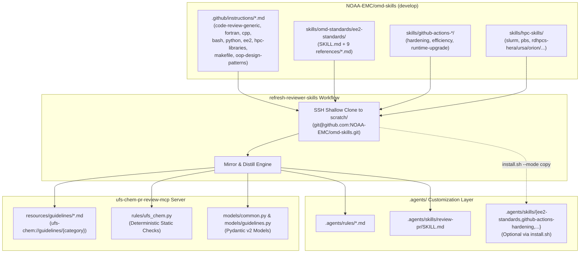

# Feature: Incorporating `NOAA-EMC/omd-skills` into `ufs-chem-pr-review-mcp` and Reviewer Skills

Refined 2026-11-03 from `design/feat/20261103-1439-incorporate-omd-skills/20261103-1439-incorporate-omd-skills.md`. Establishes a comprehensive architecture and workflow for integrating [`NOAA-EMC/omd-skills`](https://github.com/NOAA-EMC/omd-skills) into the `ufs-chem-pr-review-mcp` server, the `review-pr` deep-dive skill, and the `refresh-reviewer-skills` synchronization runbook, plus a prioritized upstream contribution roadmap of new skills and installer improvements for `NOAA-EMC/omd-skills`.

# session

- **Session ID**: `b626bc19-ee94-4daf-95a2-fd432fb01348`
- **Resume Command**: `agy --resume b626bc19-ee94-4daf-95a2-fd432fb01348`

---

## Goal

1. **Leverage `NOAA-EMC/omd-skills` across the `ufs-chem-pr-review-mcp` Server & `review-pr` Skill**:
   - Adopt `NOAA-EMC/omd-skills` as the canonical upstream source for NOAA Office of Modeling and Development (OMD) coding instructions, NCO EE2 operational standards (`ee-docs 11.0.0`), GitHub Actions security/efficiency/upgrade audits, and NOAA RDHPCS workload manager (`slurm`, `pbs`, `rdhpcs-*`) policies.
   - Expose new and updated OMD guidelines as first-class MCP resources (`ufs-chem://guidelines/{category}`), mirror `.github/instructions/*.md` into `.agents/rules/` and `src/ufs_chem_pr_review_mcp/resources/guidelines/`, and enrich deterministic static checks in `src/ufs_chem_pr_review_mcp/rules/ufs_chem.py`.
   - Upgrade `.agents/skills/review-pr/SKILL.md` with **EE2 Portability Routing (`[portable]` vs. `[WCOSS]`)**, **GitHub Actions 3-Pillar Workflow Auditing**, **RDHPCS Scheduler/Cluster Verification**, and OMD's **Interaction Loop (`Logic → Proof → Verification Command`)**.
2. **Guarantee Reliable, Repeatable Skill Refreshing from `NOAA-EMC/omd-skills`**:
   - Upgrade `.agents/skills/refresh-reviewer-skills/SKILL.md` to synchronize directly from `NOAA-EMC/omd-skills` (`develop` branch) using a resilient **SSH-first Git shallow clone + `gh api` fallback** transport strategy (solving fine-grained PAT 404 limitations on private/internal `NOAA-EMC` repos) and optional selective skill installation via `omd-skills`'s native `install.sh` / `.ompd/genesis.lock` engine.
3. **Provide Concrete Upstream Recommendations for `NOAA-EMC/omd-skills`**:
   - Deliver an actionable proposal of high-value domain skills (`pr-review`, `esmf-nuopc`, `ccpp-physics`, `cmake-hpc`, `netcdf-cf-conventions`, `spack-stack`), instruction files (`cmake.instructions.md`), and multi-agent installer enhancements (`antigravity` `.agents/rules/` adapter) to contribute back to `NOAA-EMC/omd-skills`.

---

## Pre-Design Audit (Fresh Facts, 2026-11-03)

### 1. Upstream Repository Audit (`NOAA-EMC/omd-skills` @ `develop` `0d93497` & PR #1 `dd1bc8c`)

1. **Repository Access & Transport Characteristics**:
   - Default branch is `develop` (HEAD `0d93497`, with active PR #1 at `dd1bc8c`).
   - Because `NOAA-EMC/omd-skills` is hosted under the `NOAA-EMC` organization with private/internal visibility, unauthenticated HTTPS requests (`curl https://api.github.com/repos/NOAA-EMC/omd-skills`) and `gh api` calls using fine-grained Personal Access Tokens scoped only to `ufs-community` or `benkozi` return `404 Not Found`.
   - **SSH Git transport (`git ls-remote git@github.com:NOAA-EMC/omd-skills.git` and `git clone --depth 1 git@github.com:NOAA-EMC/omd-skills.git`) succeeds immediately**, making SSH shallow cloning into `scratch/` the most reliable, token-independent synchronization mechanism.

2. **Catalog Inventory in `NOAA-EMC/omd-skills`**:
   - **`.github/copilot-instructions.md` (Master Guidelines)**:
     - Defines strict **Instruction Precedence**:
       1. *Security and Federal Compliance* (non-negotiable baseline)
       2. *EE2 Standards (`ee2-standards.md`)* (mandatory operational baseline)
       3. *Language/Domain Instructions* (stricter language rules)
       4. *Task Context*
     - Defines the 5-stage **EE2 Compliance Workflow**: *Environment Validation → Static Quality Gates → Test Gates → EE2 Policy Gates → Build/Package/Deploy*.
     - Defines MPI deadlock prevention, prohibition of root-rank full-grid aggregation (OOM prevention), and C++23 `std::mdspan` + `std::layout_left` Fortran interoperability.
   - **`.github/instructions/` (9 Path-Scoped Instruction Files)**:
     - `code-review-generic.instructions.md` (1,331 lines): OMD's comprehensive C, C++, Fortran, Python, and Bash review guide. Replaces generic web-app examples with HPC/scientific C17, C++23, Fortran 2018 (`iso_fortran_env`, `implicit none (type, external)`, `real64`, unit-stride loops, tolerance comparisons), Python (`numpy.testing.assert_allclose`, `yaml.safe_load`, context managers), Bash (`set -euo pipefail`, `unset CDPATH`, script-scoped `trap` variables, `bats-core` with faked `sbatch`/`srun` in `PATH`), per-language testing & sanitizer matrices (`-fcheck=all -ffpe-trap=invalid,zero,overflow`, ASan/UBSan/TSan, pFUnit, `fpm test`), and explicit **Operational Compliance (NCO EE2) `[portable]` vs. `[WCOSS]` scoping**.
     - `fortran.instructions.md`, `cpp.instructions.md`, `python.instructions.md`: Updated over the earlier `bbakernoaa/template-test` versions with a new Section 5 sub-section: **The Interaction Loop Sequence** (*1. The Logic → 2. The Proof (Validation Test) → 3. The Verification Command*).
     - `bash.instructions.md`, `ee2-standards.md`, `hpc-libraries.md`: Canonical OMD versions with minor link/formatting refinements.
     - `makefile.instructions.md` (410 lines): GNU Make conventions (`.PHONY`, `.DELETE_ON_ERROR`, `:=` vs `=`, order-only prerequisites `| obj`, `-MMD -MP` auto-dependencies, avoiding `$(shell ls ...)` and recursive make).
     - `oop-design-patterns.instructions.md` (99 lines): GoF patterns balanced with simplicity ("Favor function definition over class definition when the problem can be solved with a simple function").
   - **`skills/` (20 Installable Skills Across 4 Families + `skill-search`)**:
     - **`skills/omd-standards/ee2-standards/`**: Vendored from official NCO `ee-docs 11.0.0` (as of 2026-11-02) via `tools/ee2_extract.py` with traceability tests (`tests/test_ee2_traceability.py`). Contains `SKILL.md` with a **20-item EE2 Review Gate**, **Portability Routing (`[portable]` vs. `[WCOSS]`)**, and 9 reference files under `references/` (`workflow.md`, `environment-variables.md`, `file-naming.md`, `production-utilities.md`, `date-and-grib-utilities.md`, `standards.md`, `dataflow.md`, `code-delivery.md`, `examples.md`).
     - **CI/CD & GitHub Actions Skills (3)**:
       - `skills/github-actions-hardening/`: 7-step security reviewer for `.github/workflows/*.yml` (trigger privilege mapping for `pull_request_target`/`workflow_run`/`issue_comment`, `${{ github.event.* }}` script injection sinks, least-privilege `permissions:`, 40-char SHA pinning of third-party actions, `$GITHUB_ENV` heredoc safety, `persist-credentials: false`) with 5 reference docs in `references/`.
       - `skills/github-actions-efficiency/`: Audits CI waste, concurrency cancellation, lockfile caching, path filters, and matrix breadth with 5 guardrails and 4 reference docs.
       - `skills/github-actions-runtime-upgrade-conventions/`: Rules for upgrading deprecated GitHub Actions runtimes (e.g., Node.js migrations) using immutable 40-char commit SHAs with trailing version comments (`# v4.3.1`).
     - **HPC & NOAA RDHPCS Skills (`skills/hpc-skills/`, 10 skills)**:
       - `slurm` and `pbs` workload manager skills, plus 8 per-system skills (`rdhpcs-hera`, `rdhpcs-ursa`, `rdhpcs-orion`, `rdhpcs-hercules`, `rdhpcs-gaea`, `rdhpcs-ppan`, `rdhpcs-mercury`, `rdhpcs-cloud`) encoding partition/QOS limits (`batch`, `urgent`, `debug`, `long`, `windfall`, `gpu`, `gpuwf`), core/job caps, scratch purge rules, `/home` execution prohibition, and HPSS `hsi`/`htar` rules.
     - **Developer Workflow, Literature & Discovery Skills (6 + 1)**:
       - `git-commit`, `git-flow-branch-creator`, `github-issues`, `github-release`, `literature-search` (with Earth system modeling venues), `prompt-optimizer`, and top-level `skill-search`.
   - **Multi-Agent Installer (`install.sh` & `omd-skills` Python CLI)**:
     - Supports `--agents claude,codex,opencode,gemini,cursor,copilot,all`, `--mode copy|symlink`, `--domains <csv>`, `--list`, `--no-interactive`, and `--uninstall`.
     - Tracks installed files and SHA-256 checksums in `.ompd/genesis.lock` and `.ompd/genesis.lock.d/`, refusing to overwrite locally modified files (`exit 3`).

### 2. Current `ufs-chem-pr-review-mcp` Gap Analysis

1. **Stale Upstream Pointers in `.agents/skills/refresh-reviewer-skills/SKILL.md`**:
   - Currently points Tier A at generic `github/awesome-copilot` (`code-review-generic.instructions.md` with Java/Spring/SQL/React boilerplate) and Tier B at `bbakernoaa/template-test` (which lacks the new Section 5 Interaction Loop sequences, `makefile.instructions.md`, `oop-design-patterns.instructions.md`, and `omd-skills`'s scientific `code-review-generic.instructions.md`).
2. **Missing `[portable]` vs. `[WCOSS]` EE2 Distinction in Reviews**:
   - Currently, `ee2-standards.md` and `rules/ufs_chem.py` treat all EE2 rules uniformly. In research/R2O repositories like `CATChem`, `CECE`, and `HELM`, flagging missing WCOSS-only constructs (`$SENDDBN`, `prep_step`, `dbn_alert`, `JAAAAA` J-job naming) is a false positive, whereas `[portable]` EE2 rules (`FATAL ERROR:`/`WARNING:` prefixes, no background `&`, no hardcoded `/scratch` paths, no external symlinks, no dead code, fail-early input validation) apply everywhere.
3. **Missing GitHub Actions Security & Efficiency Checks**:
   - UFS-Chem PRs frequently modify `.github/workflows/*.yml`, container builds, and CI test scripts, yet `rules/ufs_chem.py` and `resources/guidelines/` do not currently encode `github-actions-hardening` (script injection via `${{ }}`, unpinned third-party actions, `pull_request_target` hazards) or `github-actions-efficiency` checks.
4. **Missing Guideline Categories in `server.py`**:
   - `list_guidelines_resource()` and `get_guidelines_resource()` in `src/ufs_chem_pr_review_mcp/server.py` expose 9 categories (`fortran`, `cpp`, `bash`, `python`, `ee2`, `hpc-libraries`, `chemistry_physics`, `esmf_nuopc`, `ponytail`), but lack `code-review-generic`, `makefile`, `github-actions`, and `rdhpcs-hpc`.

---

## Design

### 1. Question 1: How to Leverage `NOAA-EMC/omd-skills` for the Code Review MCP Server



#### 1.1 Synchronize & Expand MCP Guideline Resources (`ufs-chem://guidelines/{category}`)

1. **Update Existing Dual-Mirrored Instruction Files** (in both `src/ufs_chem_pr_review_mcp/resources/guidelines/` and `.agents/rules/`):
   - `fortran.instructions.md`: Sync Section 5 (*The Interaction Loop Sequence*: Logic → `fpm test` Proof → Verification Command).
   - `cpp.instructions.md`: Sync Section 5 (*The Interaction Loop Sequence*: Logic with `std::mdspan`/`std::layout_left` → GTest/Catch2 `Kokkos::ScopeGuard` Proof → CMake `-Wall -Wextra -Wpedantic -Werror` Verification Command).
   - `python.instructions.md`: Sync Section 5 (*The Interaction Loop Sequence*: Logic → Dual-Backend eager NumPy + lazy `.chunk()` Dask `pytest` Proof → `pre-commit` / `ruff` + `pytest` Verification Command).
   - `bash.instructions.md` and `ee2-standards.md`: Sync latest formatting and Google Shell Style link updates.
2. **Add New Guideline Resource Files to `src/ufs_chem_pr_review_mcp/resources/guidelines/` (and `.agents/rules/`)**:
   - `code-review-generic.instructions.md`: OMD's multi-language (C, C++, Fortran, Python, Bash) review standard and testing matrix from `omd-skills/.github/instructions/code-review-generic.instructions.md`.
   - `makefile.instructions.md`: GNU Make standards from `omd-skills/.github/instructions/makefile.instructions.md`.
   - `ee2-review-gate.md`: Synthesized from `omd-skills/skills/omd-standards/ee2-standards/SKILL.md` and `references/standards.md`, containing the **20-item EE2 Review Gate**, the **Portability Routing Rule (`[portable]` vs. `[WCOSS]`)**, and per-artifact checklists (`standards.md`, `file-naming.md`, `production-utilities.md`, `code-delivery.md`).
   - `github-actions.md`: Synthesized from `github-actions-hardening`, `github-actions-efficiency`, and `github-actions-runtime-upgrade-conventions` (covering `${{ }}` script injection sinks, `pull_request_target`/`workflow_run` privilege boundaries, 40-char SHA action pinning, `permissions:` least privilege, concurrency groups, lockfile caching, and matrix discipline).
   - `rdhpcs-hpc.md`: Synthesized from `skills/hpc-skills/slurm/SKILL.md` and `pbs/SKILL.md` (covering `#SBATCH`/`#PBS` resource consistency with `srun`/`OMP_NUM_THREADS`, RDHPCS QOS tiers on Hera/Ursa/Orion/Hercules/Gaea, prohibition of `/home` job execution, and `module purge` + pinned module loads).
3. **Strongly Typed Guideline Metadata Model (`GuidelineResourceInfo`)**:
   - Replace the untyped `list[dict[str, str]]` in `list_guidelines_resource()` (`src/ufs_chem_pr_review_mcp/server.py`) with a strict Pydantic v2 model in `src/ufs_chem_pr_review_mcp/models/common.py` (or `models/mcp_tools.py`):

```python
class GuidelineResourceInfo(BaseModel):
    """Metadata describing an available MCP coding or review guideline resource."""

    model_config = ConfigDict(extra="forbid")

    category: str = Field(
        description="Short identifier slug for the guideline category (e.g., 'fortran', 'ee2-review-gate', 'github-actions')."
    )
    uri: str = Field(
        description="Full MCP resource URI (e.g., 'ufs-chem://guidelines/fortran')."
    )
    description: str = Field(
        description="Concise summary of the standards, rules, and target files covered by this guideline."
    )
    upstream_source: str = Field(
        default="NOAA-EMC/omd-skills",
        description="Authoritative upstream repository or specification from which this guideline is synchronized.",
    )
```

#### 1.2 Extend Automated Deterministic Rules in `src/ufs_chem_pr_review_mcp/rules/ufs_chem.py`

Add targeted, high-precision static rules derived from `omd-skills` to `evaluate_ufs_chem_rules()` in `src/ufs_chem_pr_review_mcp/rules/ufs_chem.py`:

| Rule Name | Source Skill / Instruction in `omd-skills` | Target Files / Language | Trigger Pattern on Added Lines (`+`) | Criticality & Category |
| :--- | :--- | :--- | :--- | :--- |
| `gha_untrusted_script_injection` | `skills/github-actions-hardening/SKILL.md` (Step 2) | `.github/workflows/*.yml`, `*.yaml` | `${{ github.event.(issue\|pull_request\|comment\|review\|head_commit\|commits).* }}` or `${{ github.head_ref }}` interpolated inside a `run:` block | `5` (`CORRECTNESS`) — Critical script injection sink; pass via an intermediate `env:` variable instead. |
| `gha_unpinned_third_party_action` | `skills/github-actions-hardening/SKILL.md` (Step 5) & `runtime-upgrade-conventions` | `.github/workflows/*.yml`, `*.yaml` | `uses: <owner>/<repo>@<ref>` where `<owner>` is not `actions` or `github` and `<ref>` is not a 40-char hex SHA | `4` (`BUILD_PACKAGING`) — Mutable tag/branch supply-chain risk; pin third-party actions to a full 40-character commit SHA with `# vX.Y.Z` comment. |
| `fortran_exact_float_equality` | `.github/instructions/code-review-generic.instructions.md` (Fortran Numerics) | `SupportedLanguage.FORTRAN` | `if\s*\([^)]*(?:==|\.eq\.|/=|\.ne\.)\s*0\.0(?:_[a-zA-Z0-9]+|[dDeE][+-]?\d+)?\b` | `4` (`CHEMISTRY_PHYSICS`) — Exact floating-point equality/inequality comparison on reals breaks reproducibility across compilers and rank counts; use an explicit tolerance (`abs(x) <= tol`). |
| `c_unsafe_buffer_or_shell_call` | `.github/instructions/code-review-generic.instructions.md` (C Buffers & Security) | `SupportedLanguage.C`, `SupportedLanguage.CPP` | `\b(?:strcpy|strcat|sprintf|vsprintf|gets)\s*\(` | `5` (`CORRECTNESS`) — Unbounded buffer write risk; use `snprintf` with size check or RAII `std::string`. |
| `ee2_missing_fatal_error_prefix` | `skills/omd-standards/ee2-standards/SKILL.md` (Gate #2, `[portable]`) | `SupportedLanguage.SHELL` (`jobs/`, `scripts/`, `ush/`) | `echo\s+["'](?:ERROR|Error|FATAL|Fatal)\b(?![^"']*FATAL ERROR:)` before `exit [1-9]` | `3` (`STYLE_DOCS`) — `[portable]` EE2 standard requires fatal error messages to begin with the exact prefix `FATAL ERROR:`. |

#### 1.3 Upgrade `.agents/skills/review-pr/SKILL.md` with `omd-skills` Workflows

1. **Phase 2 & Phase 4 — GitHub Actions 3-Pillar Audit (`github-actions-*`)**:
   - Whenever `.github/workflows/*.yml` or `.github/actions/**` are among the PR's changed files, instruct the reviewer agent to apply the `omd-skills` GitHub Actions triad:
     - **Hardening**: Map trigger trust levels (`pull_request` vs. `pull_request_target`/`workflow_run`/`issue_comment`), hunt `${{ github.event.* }}` script injection in `run:` blocks, verify `permissions:` least privilege, and check 40-char SHA pinning on third-party actions.
     - **Efficiency**: Check `concurrency:` cancellation groups on PR workflows, lockfile-keyed dependency caches, and unnecessary duplicate workflow triggers while respecting the 5 efficiency guardrails (never drop required validation).
     - **Runtime Upgrades**: Verify action upgrades use full 40-char commit SHAs with `# vX.Y.Z` trailing comments.
2. **Phase 3 & Phase 4 — EE2 Portability Routing (`[portable]` vs. `[WCOSS]`)**:
   - Incorporate the `ee2-standards` Portability Routing rule directly into Phase 3 (Comment Validity Evaluation) and Phase 4 (OMD Standards Lens):
     - Classify the target repository/PR context:
       - **Research / R2O Component (`CATChem`, `CECE`, `HELM`, `ufs-chem-container`, `ufs-chem-assay` on RDHPCS/workstation/CI)**: Apply only the **`[portable]`** EE2 subset (message prefixes `FATAL ERROR:` / `WARNING:`, no backgrounding `&`, no hardcoded paths, no external symlinks, ASCII output, dead-code removal, fail-early with specific missing file names). Explicitly mark any peer reviewer comment demanding `[WCOSS]`-only mechanics (`$SENDDBN`, `prep_step`, `dbn_alert`, `JAAAAA` naming, PBS directives on Slurm scripts) as **`[INVALID / FALSE POSITIVE]`** citing `omd-skills/skills/omd-standards/ee2-standards/SKILL.md` Portability Routing.
       - **Operational NCO / WCOSS2 Delivery (`jobs/J*`, `scripts/ex*.sh`, `.ecf` job cards)**: Apply the full 20-item EE2 Review Gate (`[portable]` + `[WCOSS]`).
3. **Phase 4 — Per-Language Testing & Compiler Flag Expectations (`code-review-generic.instructions.md`)**:
   - Incorporate `omd-skills`'s per-language testing and debug-flag checklist:
     - **Fortran**: Check that debug/test builds use `-fcheck=all -ffpe-trap=invalid,zero,overflow -warn all -traceback` (or Intel `-check all -fpe0 -traceback`), MPI tests cover `-np 1`, `-np 2`, and decomposed rank counts, and `-ffast-math`/`-Ofast` is never added without a documented tolerance check.
     - **C/C++**: Check CTest registration (`add_test` / `gtest_discover_tests`), Rule-of-Five copy/move tests, and sanitizer coverage (`-fsanitize=address,undefined`).
     - **Python**: Check `numpy.testing.assert_allclose` with explicit `rtol`/`atol`, seeded RNG (`np.random.default_rng(seed)`), and dual-backend (eager NumPy + lazy Dask `.chunk()`) verification for Pangeo pipelines.
     - **Bash & HPC Job Scripts**: Check `shellcheck` cleanliness, script-scoped `trap` cleanup variables (never `local` inside a function when read by an `EXIT` trap under `set -u`), and `#SBATCH`/`#PBS` resource consistency (`--ntasks` vs `srun -n`, `--cpus-per-task` vs `OMP_NUM_THREADS`, `module purge` before pinned `module load`, no job execution from `/home`).

---

### 2. Question 2: Ensuring Reliable Skill Refreshing from `NOAA-EMC/omd-skills`

#### 2.1 Why `refresh-reviewer-skills` Needs a Dual-Transport Fetch Strategy

During the pre-design audit, testing `gh api repos/NOAA-EMC/omd-skills` revealed a critical operational nuance:
- Users in the UFS-Chem ecosystem often configure `gh` with a fine-grained PAT scoped to `ufs-community` and personal forks. Because `NOAA-EMC/omd-skills` lives in the `NOAA-EMC` organization and is private/internal, `gh api repos/NOAA-EMC/omd-skills/...` fails with HTTP 404 under a repo-scoped fine-grained token.
- Conversely, **SSH Git access (`git@github.com:NOAA-EMC/omd-skills.git`) uses the developer's SSH key and succeeds in <2 seconds**, fetching the entire `develop` tree in a single shallow clone.

#### 2.2 Updated Upstream Sync Procedure in `.agents/skills/refresh-reviewer-skills/SKILL.md`

We update `.agents/skills/refresh-reviewer-skills/SKILL.md` so that **Tier B (`NOAA-EMC/omd-skills`)** is fetched via an SSH-first shallow clone into `scratch/upstream_omd_skills` (with `gh api` as a fallback if SSH is unavailable):

```bash
# 1. Fetch NOAA-EMC/omd-skills (develop branch) via shallow SSH clone (Primary)
rm -rf scratch/upstream_omd_skills
if git clone --depth 1 --branch develop git@github.com:NOAA-EMC/omd-skills.git scratch/upstream_omd_skills 2>/dev/null; then
  echo "Fetched NOAA-EMC/omd-skills (develop) via SSH shallow clone: $(git -C scratch/upstream_omd_skills rev-parse --short HEAD)"
else
  # Fallback to HTTPS / gh repo clone if SSH key is not loaded
  gh repo clone NOAA-EMC/omd-skills scratch/upstream_omd_skills -- --depth 1 --branch develop
fi
```

#### 2.3 Two Complementary Refresh Modes for `omd-skills`

1. **Mode 1 — Automated Guideline Mirroring & Distillation (Always Run During `refresh-reviewer-skills`)**:
   - Diff `scratch/upstream_omd_skills/.github/instructions/*.md` against local `src/ufs_chem_pr_review_mcp/resources/guidelines/` and `.agents/rules/`.
   - Copy verbatim updates for `fortran.instructions.md`, `cpp.instructions.md`, `bash.instructions.md`, `python.instructions.md`, `ee2-standards.md`, `hpc-libraries.md`, `makefile.instructions.md`, and `code-review-generic.instructions.md` into `src/ufs_chem_pr_review_mcp/resources/guidelines/` and `.agents/rules/`.
   - Diff `scratch/upstream_omd_skills/skills/omd-standards/ee2-standards/`, `skills/github-actions-*/`, and `skills/hpc-skills/` against `src/ufs_chem_pr_review_mcp/resources/guidelines/{ee2-review-gate,github-actions,rdhpcs-hpc}.md` and `.agents/skills/review-pr/SKILL.md`.
   - Record the synced `NOAA-EMC/omd-skills` commit SHA and date in the refresh report.

2. **Mode 2 — Optional Direct Skill Placement via `omd-skills/install.sh` (Companion Skills)**:
   - Because `omd-skills/install.sh` installs skills into `.agents/skills/<skill-name>/` (when `--agents gemini` or `codex` is selected) and tracks them in `.ompd/genesis.lock` without touching existing foreign skills (`review-pr`, `refresh-review-db`, `refresh-reviewer-skills`), developers can optionally install upstream OMD skills directly into `.agents/skills/`:
     ```bash
     scratch/upstream_omd_skills/install.sh \
       --project . \
       --agents gemini \
       --domains omd-standards,github-actions-hardening,github-actions-efficiency,github-actions-runtime-upgrade-conventions,hpc-skills \
       --mode copy \
       --no-interactive
     ```
   - **Important Guardrail**: Notice that `--agents gemini` in `omd-skills/install.sh` also writes a managed block into `GEMINI.md` (`block|GEMINI.md`). In Mode 1 (our default for `ufs-chem-pr-review-mcp`), we mirror `.github/instructions/*.md` directly into `.agents/rules/` and `src/ufs_chem_pr_review_mcp/resources/guidelines/` rather than creating a monolithic `GEMINI.md`, keeping the repository root clean. We also add `.ompd/` to `.gitignore` so local installer state is never accidentally tracked.

---

### 3. Question 3: Suggested Additions & Improvements to `NOAA-EMC/omd-skills`

Based on our audit of `NOAA-EMC/omd-skills` (`develop` @ `0d93497` and PR #1 @ `dd1bc8c`) and real-world code reviews across `CATChem`, `CECE`, `HELM`, and `ufs-chem-container`, we recommend contributing the following **8 high-impact additions** to `NOAA-EMC/omd-skills`:

#### 3.1 Recommended New Skills (`skills/<domain>/<skill>/`)

| Proposed Skill Path in `omd-skills` | Target Domain & Gap Addressed | Key Contents & Capabilities to Include |
| :--- | :--- | :--- |
| **1. `skills/code-review/pr-review/`** *(or `skills/omd-standards/scientific-pr-review/`)* | **End-to-End Pull Request Code Review Workflow**: `omd-skills` currently has `.github/instructions/code-review-generic.instructions.md` (passive editor rules), but **no runnable skill in `skills/`** for conducting a structured PR review. | - Pinned revision anchoring (`baseRefOid..headRefOid`) & Logical File Grouping.<br/>- Fetching submitted + pending review comments and evaluating technical validity (`[VALID]`, `[INVALID / FALSE POSITIVE]`, `[OUTDATED]`, `[PARTIALLY VALID]`).<br/>- CI False-Confidence / Conditional Test Gating detection (`if(EXISTS ...)` CTest skips, manual pre-commit hooks).<br/>- Ready-to-post comment template (`**[Category]: [Title]**`, 2–5 sentence prose, `**Suggested fix:**`, `**Test:**`, $\le 15$-line `suggestion` fence limit).<br/>- Pending-only `review_payload.json` generation (omitting `"event"` so `gh api` only ever creates a safe `PENDING` draft review). |
| **2. `skills/coupled-modeling/esmf-nuopc/`** | **ESMF & NUOPC Cap Engineering**: `hpc-libraries.md` has 3 bullets on ESMF, which is too brief for reviewing or writing NUOPC caps across UFS (`MOM6`, `CATChem`, `CECE`, `CMEPS`, `CICE6`, `WW3`). | - NUOPC specialization lifecycle (`InitializeP0`, `InitializeP1/Advertise`, `InitializeP2/Realize`, `DataInitialize`, `SetClock`, `ModelAdvance`, `Finalize`).<br/>- Mandatory `ESMF_LogFoundError(rcToCheck=rc, msg=ESMF_LOGERR_PASSTHRU, line=__LINE__, file=__FILE__, rcToReturn=rc)` idiom.<br/>- `ESMF_Grid` / `ESMF_Mesh` stagger locations (`ESMF_STAGGERLOC_CENTER` vs `CORNER`), explicit cell bounds (`lon_bnds`/`lat_bnds`), spherical excess area vs. lat-strip area conservation, and antimeridian (`0..360` vs `-180..180`) seam handling.<br/>- Preventing memory leaks on temporary `ESMF_Field` / `ESMF_RouteHandle` / `ESMF_State` objects. |
| **3. `skills/coupled-modeling/ccpp-physics/`** | **CCPP Physics & Atmospheric Chemistry Schemes**: Standardizes CCPP (`ccpp-framework` / `ccpp-physics` / `CATChem`) scheme authoring and review. | - `.meta` metadata table synchronization with Fortran argument lists (`standard_name`, `units`, `dimensions`, `type`, `kind`, `intent`).<br/>- Pure column physics kernel rules (`errmsg`, `errflg` output contract; zero internal I/O or `stop`).<br/>- Vertical level indexing conventions (surface-to-top vs. top-to-surface) and molar-to-mass mixing ratio conversions ($M_{\text{spec}} / M_{\text{air}}$). |
| **4. `skills/omd-standards/cmake-hpc/`** *(plus `.github/instructions/cmake.instructions.md`)* | **CMake, `ecbuild`, & CTest for HPC**: `omd-skills` has `makefile.instructions.md`, but modern NOAA UFS/OMD/EMC repositories (`MOM6`, `UFS-WM`, `CATChem`, `CECE`, `HELM`, `JEDI`) primarily build with **CMake + `ecbuild`**. | - Modern target-based CMake (`target_link_libraries`, `target_include_directories`, `Fortran_MODULE_DIRECTORY` isolation).<br/>- Safe `find_package(MPI / NetCDF / ESMF / PIO / Kokkos)` patterns and `ecbuild_add_executable` / `ecbuild_add_test`.<br/>- **Anti-Pattern Gate**: Forbid silent `if(EXISTS ${LARGE_DATA_FILE})` test skipping in CI without an explicit warning or synthetic micro-fixture fallback.<br/>- Compiler flag hygiene across `GNU`, `IntelLLVM` (`ifx`/`icpx`), and `Cray` toolchains. |
| **5. `skills/omd-standards/netcdf-cf-conventions/`** | **CF Metadata, NetCDF-4/HDF5 Parallel I/O & Zarr**: Expands data format correctness checks for ocean and atmospheric models. | - `CF-1.8+` attribute requirements (`units`, `standard_name`, `coordinates`, `cell_methods`, `bounds` with 2-D `lat_bnds`/`lon_bnds`).<br/>- `_FillValue` vs `missing_value` type-matching and NaN guardrails.<br/>- Collective parallel I/O (`NF90_COLLECTIVE` / PIO `PIO_iotype_pnetcdf` vs `PIO_iotype_netcdf4p`) and chunking strategies. |
| **6. `skills/hpc-skills/spack-stack/`** | **NOAA `spack-stack` Environments**: Complements the `rdhpcs-*` skills with unified environment management used across Hera, Ursa, Orion, Hercules, Gaea, and WCOSS2. | - Loading pre-installed `spack-stack` modules on each RDHPCS platform.<br/>- Creating developer extension environments (`spack env create`, `spack.yaml` upstream chaining, `spack concretize -f`, `spack install`).<br/>- Preventing mixed MPI/compiler ABI symbol collisions when loading `spack-stack` modules in Slurm/PBS job scripts. |

#### 3.2 Recommended Installer & Repository Policy Enhancements in `NOAA-EMC/omd-skills`

1. **Add First-Class `antigravity` (`agy`) Adapter Support in `tools/installer/adapters.sh`**:
   - **Current limitation**: `ADAPTER_IDS="claude codex opencode gemini cursor copilot"`. When `--agents gemini` or `codex` is used, `adapter_instruction()` returns `block|GEMINI.md` or `block|AGENTS.md`, concatenating all 9 `.github/instructions/*.md` files into a single 2,000-line markdown file at the repo root and losing file-extension `applyTo` scoping.
   - **Proposed improvement**: Add `antigravity` (or enhance `gemini`) to support `.agents/skills/<skill>/` for skills and `files|.agents/rules|verbatim` for `.github/instructions/*.md` so Antigravity IDE/CLI loads path-scoped rules natively from `.agents/rules/*.md`.
2. **Reconcile `.github/skills/speckit-*` vs `skills/` Catalog Discovery**:
   - Currently, 10 `speckit-*` skills (`speckit-specify`, `speckit-plan`, `speckit-tasks`, `speckit-implement`, `speckit-analyze`, `speckit-checklist`, `speckit-clarify`, `speckit-constitution`, `speckit-converge`, `speckit-taskstoissues`) live under `.github/skills/` in `omd-skills`, which makes them invisible to `install.sh --list` and `skill-search` (which only scan `skills/`). Either promote them to `skills/spec-kit/` so `install.sh` can install them across all agents, or document in `README.md` that `.github/skills/speckit-*` are repo-internal maintainer skills.
3. **Transition Lockfile & Managed-Block Naming from `genesis` to `omd-skills` (with Backward Compatibility)**:
   - `tools/installer/record.sh` and `rules.sh` still use `.ompd/genesis.lock` and `<!-- genesis-skills:begin ... -->` markers inherited from DOE ModCon `genesis-skills`. Supporting `<!-- omd-skills:begin ... -->` (while still recognizing `genesis-skills` markers on upgrade/uninstall) will align the lock markers with the `omd-skills` package name.

---

## Implementation Plan (Red-Green-Refactor)

### Phase 1: Pydantic Models & Guideline Resource Catalog Expansion (TDD Red -> Green)
1. **Red**: Add unit tests in `tests/test_mcp_server.py`:
   - Verify `list_guidelines_resource()` returns valid JSON deserializable into `list[GuidelineResourceInfo]` where every item has `category`, `uri`, `description`, and `upstream_source`.
   - Verify new guideline categories (`code-review-generic`, `makefile`, `ee2-review-gate`, `github-actions`, `rdhpcs-hpc`) are listed in `ufs-chem://guidelines` and return non-empty markdown via `ufs-chem://guidelines/{category}`.
2. **Green**:
   - Define `GuidelineResourceInfo` in `src/ufs_chem_pr_review_mcp/models/mcp_tools.py` with `Field(description=...)` on all fields and `ConfigDict(extra="forbid")`.
   - Sync updated instruction files (`fortran.instructions.md`, `cpp.instructions.md`, `bash.instructions.md`, `python.instructions.md`, `ee2-standards.md`, `hpc-libraries.md`) and new guideline files (`code-review-generic.instructions.md`, `makefile.instructions.md`, `ee2-review-gate.md`, `github-actions.md`, `rdhpcs-hpc.md`) into `src/ufs_chem_pr_review_mcp/resources/guidelines/` and `.agents/rules/`.
   - Update `list_guidelines_resource()` and `get_guidelines_resource()` in `src/ufs_chem_pr_review_mcp/server.py`.

### Phase 2: Deterministic `omd-skills` Rules in `rules/ufs_chem.py` (TDD Red -> Green)
1. **Red**: Add unit tests in `tests/test_rules_ufs_chem.py` testing:
   - `gha_untrusted_script_injection` on `.github/workflows/ci.yml` when `${{ github.event.pull_request.title }}` or `${{ github.head_ref }}` appears inside a `run:` step (and confirming safe `env:` usage does not trigger).
   - `gha_unpinned_third_party_action` on `.github/workflows/ci.yml` when a third-party action uses `@v1` or `@main` (and confirming 40-char SHA or `actions/checkout@v4` first-party rule handling).
   - `fortran_exact_float_equality` on Fortran diffs containing `if (residual == 0.0_rk)` or `if (val .eq. 0.0)`.
   - `c_unsafe_buffer_or_shell_call` on C/C++ diffs containing `strcpy(`, `sprintf(`, or `gets(`.
   - `ee2_missing_fatal_error_prefix` on shell scripts echoing `"ERROR: ..."` without `FATAL ERROR:`.
2. **Green**:
   - Update `detect_language` in `src/ufs_chem_pr_review_mcp/ingest/classifier.py` if needed (or inspect `file_path` for `.github/workflows/*.yml`) and implement the 5 new deterministic checks in `src/ufs_chem_pr_review_mcp/rules/ufs_chem.py`.
3. **Refactor**: Ensure regexes are compiled at module import time and all `DomainFinding` objects include clear explanations citing the corresponding `omd-skills` guideline.

### Phase 3: Update `.agents/skills/refresh-reviewer-skills/SKILL.md` & `.agents/skills/review-pr/SKILL.md`
1. Update `.agents/skills/refresh-reviewer-skills/SKILL.md`:
   - Promote `NOAA-EMC/omd-skills` (`develop` branch) to the primary authoritative source in Tier A/B.
   - Replace fragile `bbakernoaa/template-test` API calls with the resilient SSH-first shallow clone (`git clone --depth 1 --branch develop git@github.com:NOAA-EMC/omd-skills.git scratch/upstream_omd_skills` with `gh repo clone` fallback).
   - Document both Mode 1 (Automated Guideline Mirroring & Distillation) and Mode 2 (Optional Companion Skill Installation via `install.sh --agents gemini --mode copy`).
2. Update `.agents/skills/review-pr/SKILL.md`:
   - Add **EE2 Portability Routing (`[portable]` vs. `[WCOSS]`)** to Phase 3 (Comment Validity Evaluation) and Phase 4 (OMD Standards Lens).
   - Add **GitHub Actions 3-Pillar Audit** (Hardening, Efficiency, Runtime Upgrades) to Phase 2/Phase 4 when `.github/workflows/*` are modified.
   - Add **RDHPCS & Scheduler Consistency Checks** (`#SBATCH`/`#PBS` vs `srun`/`OMP_NUM_THREADS`, `/home` restriction, `module purge`) and per-language testing/sanitizer expectations from `omd-skills`.
3. Update `.gitignore` to ignore `.ompd/` (in case a user runs `omd-skills/install.sh` locally).

### Phase 4: Documentation & Quality Gates (`design.md`, `README.md`, `pytest`, `pre-commit`)
1. Update `design/design.md` and `README.md` to document the new `ufs-chem://guidelines/{category}` resources, the new `omd-skills` static rules, and the `NOAA-EMC/omd-skills` synchronization workflow.
2. Run `uv run pytest`, `uv run pytest --dry-run`, and `pre-commit run --all-files` to verify 100% test pass rate and lint compliance.

---

## Verification Matrix

| Target | Verification Command / Check | Expected Outcome |
| :--- | :--- | :--- |
| **Guideline Models & Resources** | `uv run pytest tests/test_mcp_server.py` | All 14 guideline categories resolve via `ufs-chem://guidelines/{category}` and validate against `GuidelineResourceInfo`. |
| **`omd-skills` Static Rules** | `uv run pytest tests/test_rules_ufs_chem.py` | Unit tests for `gha_untrusted_script_injection`, `gha_unpinned_third_party_action`, `fortran_exact_float_equality`, `c_unsafe_buffer_or_shell_call`, and `ee2_missing_fatal_error_prefix` pass 100%. |
| **Markdown Parser Compatibility** | `uv run pytest tests/test_local_review_parser.py` | `parse_review_markdown_findings` remains 100% compatible with `.agents/skills/review-pr/SKILL.md`. |
| **Dry-Run & Full Test Suite** | `uv run pytest --dry-run && uv run pytest` | All test suites collect and pass with zero warnings/errors. |
| **Pre-Commit & Type Hygiene** | `pre-commit run --all-files` | `ruff`, `mypy`, and all hooks pass with zero `Any` regressions. |

---

# appendix: original notes

## always do

- include updating design.md as part of the implementation
- update README.md with any necessary documentation changes in case of an api adjustment
- use pydantic models as opposed to dataclasses
  - all pydantic fields should include a description like `... = Field(description="<description content here>", ...`
- do *not* add driver bugs to known bugs in `README.md` unless explicitly told to do so
- use a test-driven development, red-green-refactor approach for all fixes and features (when possible)
- maintain original design sections when refining design docs - create an appendix
  - summarize conversational updates in the appendix following original refinement target
  - refinements never create files. they only edit the target document that is being refined.
  - `design.md` may be updated during the _implementation_ phase only.
- when using python `typing`, avoid `Any` as much as possible
- **never, ever, ever** commit code or use git actions that perform updates - the user always updates
- always prefer the harness's logging implementation over raw python print statements
- no need for wrapping when writing to the `./design` folder. wrapping will be handled by the user's ide
- persist the agy session id and resume command in any design/refined files for resumability

## session

- **Session ID**: `<session-id>`
- **Resume Command**: `agy --resume <session-id>`

### testing

- not necessary for design documents in the `spike` folder - code *should not* change for spikes
- *all* suites should pass `--dry-run`
- no need to run tests for spikes/documentation-only tasks
- pre-commit hooks pass

## requirements

- how can we leverage https://github.com/NOAA-EMC/omd-skills for the code review mcp server?
- ensure that we can refresh our skills using the repository
- would you suggest any addtions to omd-skills?

## conversational updates

- **2026-11-03 (Initial Refinement)**:
  1. **Pre-Design Audit of `NOAA-EMC/omd-skills`**: Inspected `NOAA-EMC/omd-skills` (`develop` @ `0d93497` and PR #1 @ `dd1bc8c`) via SSH shallow clone in conversation scratch space (and cleaned up the temporary clone immediately after inspection). Cataloged all 9 `.github/instructions/*.md` files (`code-review-generic.instructions.md`, `fortran.instructions.md`, `cpp.instructions.md`, `bash.instructions.md`, `python.instructions.md`, `ee2-standards.md`, `hpc-libraries.md`, `makefile.instructions.md`, `oop-design-patterns.instructions.md`), `.github/copilot-instructions.md`, all 20 skills under `skills/` (`omd-standards/ee2-standards` with 9 reference files from `ee-docs 11.0.0`, `github-actions-hardening`, `github-actions-efficiency`, `github-actions-runtime-upgrade-conventions`, 10 `hpc-skills` for `slurm`, `pbs`, and RDHPCS clusters, plus developer workflow and literature skills), and the `install.sh` / `omd-skills` CLI installer.
  2. **Leveraging `omd-skills` in `ufs-chem-pr-review-mcp` & `review-pr`**:
     - Designed expansion of `ufs-chem://guidelines` and `ufs-chem://guidelines/{category}` with strongly-typed `GuidelineResourceInfo` Pydantic v2 models (`extra="forbid"`, descriptive `Field(description=...)`) and 5 new/synthesized guideline categories (`code-review-generic`, `makefile`, `ee2-review-gate`, `github-actions`, `rdhpcs-hpc`), plus syncing the new Section 5 *Interaction Loop Sequence* (`Logic → Proof → Verification Command`) into `fortran`, `cpp`, and `python` instructions.
     - Designed 5 new deterministic static rules in `src/ufs_chem_pr_review_mcp/rules/ufs_chem.py` (`gha_untrusted_script_injection`, `gha_unpinned_third_party_action`, `fortran_exact_float_equality`, `c_unsafe_buffer_or_shell_call`, `ee2_missing_fatal_error_prefix`).
     - Designed `review-pr` runbook enhancements incorporating `ee2-standards` **Portability Routing (`[portable]` vs. `[WCOSS]`)** so research/RDHPCS PRs are not falsely flagged for WCOSS-only constructs, plus the GitHub Actions 3-pillar review lens and RDHPCS scheduler checks.
  3. **Refreshing Skills from `NOAA-EMC/omd-skills`**:
     - Identified why `gh api repos/NOAA-EMC/omd-skills` returns HTTP 404 when a fine-grained PAT is scoped only to `ufs-community`/`benkozi`, and designed an SSH-first shallow clone workflow (`git clone --depth 1 --branch develop git@github.com:NOAA-EMC/omd-skills.git scratch/upstream_omd_skills`) in `.agents/skills/refresh-reviewer-skills/SKILL.md`, supporting both automated guideline distillation (Mode 1) and optional companion skill installation via `install.sh` (Mode 2).
  4. **Suggested Additions to `NOAA-EMC/omd-skills`**:
     - Formulated 6 new skill proposals (`skills/code-review/pr-review/`, `skills/coupled-modeling/esmf-nuopc/`, `skills/coupled-modeling/ccpp-physics/`, `skills/omd-standards/cmake-hpc/` + `cmake.instructions.md`, `skills/omd-standards/netcdf-cf-conventions/`, and `skills/hpc-skills/spack-stack/`) and 3 installer/repo enhancements (`antigravity` `.agents/rules/` adapter in `tools/installer/adapters.sh`, `speckit-*` catalog visibility, and `genesis.lock` → `omd-skills` marker migration).
  5. Preserved all original notes in the appendix, recorded the session ID (`b626bc19-ee94-4daf-95a2-fd432fb01348`), and modified only the target design document (`design/feat/20261103-1439-incorporate-omd-skills/20261103-1439-incorporate-omd-skills.md`).
